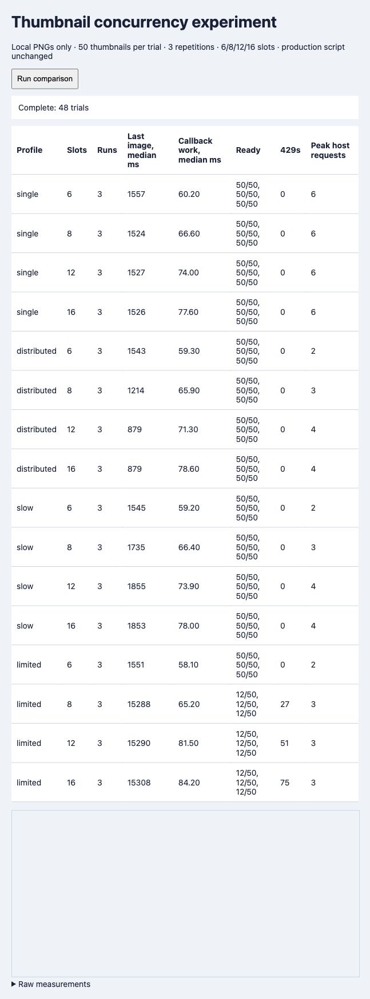

# Thumbnail concurrency experiment

This is the historical fixed-limit experiment on 2.7.7. The subsequent 2.8.0 implementation uses [automatic per-host pacing](ADAPTIVE-HOSTS.md).

October 23, 2026. Shipped version 2.7.7 remains unchanged; default 6 and advanced maximum 8 are retained. Tested artifact SHA-256: `cfc674325cc9fb67da2e3dcb5da8cce4c4aca209e2437e35fb863d84c158baad`.

The evidence supports keeping six as the general default. Higher concurrency speeds a spare-capacity multi-origin workload, but provides little gain for our single HTTP/1.1 origin, increases script work, slows constrained origins, and triggers more failures under an enforced host limit. These are controlled local results, not measurements of Empornium image-host capacity.

## Method

48 native in-app Chromium trials: 50 neutral 160×96 PNGs per page, four slot limits 6/8/12/16, four host profiles and three repetitions. Trial order reverses in the middle repetition. Unique URLs and no-store headers ensure network requests. The instrumented bundle changes only the test validator maximum and adds measurement hooks; the release file is untouched. Persistent GM behavior is mocked, as in earlier browser fixtures. No external image host or production account is contacted.

Three loopback origins use ports 8770–8772. Single uses one origin at 160ms response delay. Distributed uses three with 160ms delay. Slow uses three with an additional 140ms for each overlapping request above two per origin. Limited returns 429 when more than two requests overlap per origin. Automatic retries are disabled to avoid amplification and isolate pressure; the existing global circuit breaker remains enabled. Each trial has a 20-second deadline. The limits are deliberately synthetic and do not claim to model any specific image host.

The first-six metric records load events, not a guaranteed above-fold viewport. Last-image timing is meaningful as full-page completion only when 50/50 succeed. Callback work sums timed animation-frame and MutationObserver callbacks, excluding general parsing and image decoder threads. Long Tasks and frame gaps provide separate responsiveness checks. These are not whole-process CPU percentages. The full regression suite ran during one limited-host trial; comparisons of CPU cost use the three non-limited profiles. Browser/native caching, transport protocol and background system work remain sources of variation.

## Median loading times

All values are milliseconds; each healthy cell represents 3/3 complete 50-image trials.

| Slots | Single HTTP/1.1 origin | Three responsive origins | Three slowing origins | First 6, responsive origins | Callback work, median across non-limited profiles |
| --- | ---: | ---: | ---: | ---: | ---: |
| 6 | 1557 | 1543 | 1545 | 218 | 59.4 |
| 8 | 1524 | 1214 | 1735 | 227 | 66.4 |
| 12 | 1527 | 879 | 1855 | 228 | 73.9 |
| 16 | 1526 | 879 | 1853 | 230 | 78.0 |

Higher settings did not make the first six images meaningfully earlier. Peak actual requests for the responsive three-origin case were 6/8/12/12, despite scheduler peaks 6/8/12/16. The experiment observes that plateau without assuming its cause. The single-origin case stayed at six actual requests at every setting. HTTP/1.1 commonly has per-origin connection limits; HTTP/2 multiplexing behaves differently, so these transport results cannot be projected directly onto production HTTP/2. [MDN connection management](https://developer.mozilla.org/en-US/docs/Web/HTTP/Guides/Connection_management_in_HTTP_1.x). The experiment does not add domain sharding to the product.

## Simulated rate limiting

| Slots | Ready out of 50, each repetition | Total 429s across 3 trials | Median trial end, ms | Peak requests to one origin |
| --- | --- | ---: | ---: | ---: |
| 6 | 50, 50, 50 | 0 | 1591 | 2 |
| 8 | 12, 12, 12 | 27 | 20029 | 3 |
| 12 | 12, 12, 12 | 51 | 20022 | 3 |
| 16 | 12, 12, 12 | 75 | 20033 | 3 |

Incomplete high-concurrency trials hit the 20-second deadline. They are failures to finish, not faster completions. The existing global circuit breaker pauses after failures on six distinct assets; it is not a per-host capacity controller and may stall healthy origins along with the constrained one. Failed-small/original fallback with default retries could add further traffic; this experiment intentionally suppresses that amplification.

## CPU and reliability

The 36 non-limited trials all loaded 50/50 images with exactly 50 server image requests. One 53ms Long Task appeared in a 16-slot slow-origin trial; no non-limited Long Tasks appeared at 6, 8 or 12. Non-limited 95th-percentile frame gaps stayed below 10ms in this browser run. Higher slots increased callback work even where request throughput plateaued. Worker-thread image decode and total process CPU were not profiled, so this does not establish a total CPU ceiling.

Four scheduler tests additionally verify all experimental capacities, bounded peak slots, no duplicate successful transfers, queue drainage, and two ordinary large-image slots plus reserved hover capacity. The full unchanged-artifact regression passes 175 checks. [JUnit](qa/concurrency-full-2026-10-23.xml).

## Decision

Retain the default 6 and shipped advanced maximum 8. Do not expose 12/16 or change users’ settings based on this local experiment. 8 can help genuinely independent, responsive origins, but it is not an unconditional improvement. A future increase should first add per-origin admission/backoff and be checked with bounded 6-versus-8 runs in the actual Chrome/Tampermonkey environment, recording image protocol, cache state, errors and hover latency. Independent hostnames may share the same backend; per-host caps alone cannot prove server safety. Multiple tabs multiply the current per-tab limit.

Reproduce with the pinned Node 24 runtime: `node test/concurrency-benchmark.mjs`, then open `http://127.0.0.1:8770/` and select Run comparison. Only loopback listeners are opened. [Raw 48-trial evidence](qa/concurrency-2026-10-23.json).

