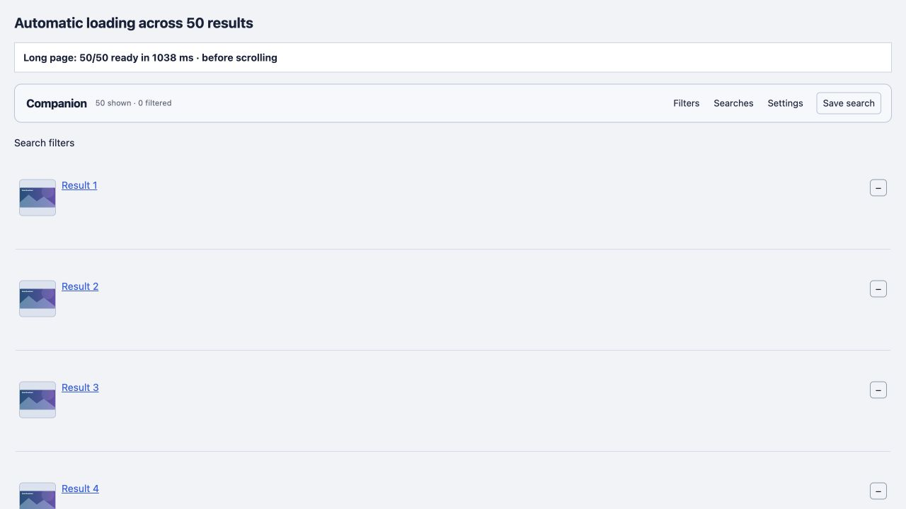
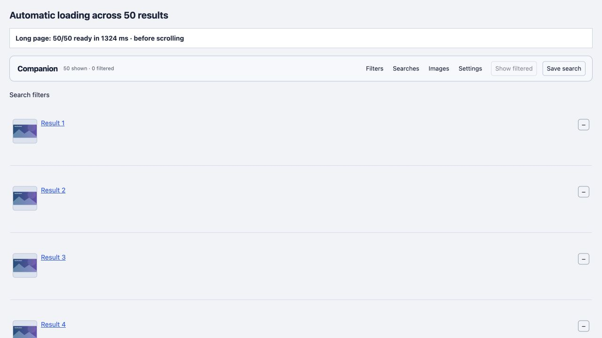

# Thumbnail loading changes

## Adaptive pacing, version 2.8.0

[Automatic host pacing](ADAPTIVE-HOSTS.md) combines a conservative cold start, gradual host-specific growth, local latency/error backoff and persisted advisory limits. Active counters replace repeated cached-entry scans. The 60-trial comparison shows all automatic loads complete, learned constrained hosts stop producing simulated errors, and selected callback work is roughly halved versus fixed limits. Unknown single-host first loads are slower while capacity is learned. The final 800-row pass has zero idle scans and no steady-state Long Tasks; 50-row insertion retains one Long Task. These are local measurements, not live-host capacity or total browser CPU claims. [Raw comparisons](qa/adaptive-hosts-280.json), [CPU](qa/performance-800-280.json).

## Historical fixed-limit comparison (2.7.7), October 23, 2026

[48 native browser trials](CONCURRENCY-EXPERIMENT.md) compare 6/8/12/16 slots. Keep 6 as the general default: responsive multi-origin loads improve, but single-origin loads plateau and slowing/rate-limited origins regress. CPU observations cover script callbacks, Long Tasks and frame gaps rather than whole-process CPU. No product settings or live-host traffic were changed. The upper experimental limits exist only in the benchmark bundle.

## Collage cover loading, version 2.7.7

Native Cover Art cards use original images as CSS backgrounds, including large GIFs. The early document-start CSS gate suppresses those eager requests while sources remain available for restoration. Small variants load directly into the card's image node through the existing six-slot queue. All displayed cards on the current page warm without scrolling; hidden cards wait. Original fallback has two ordinary large-image slots and the full-image deadline; hover retains its reserved interactive slot. Larger images replace the hover preview only after success. Existing thumbnail/recovery options apply without extra settings.

The neutral native-shaped 28-card browser check completed all small covers in 401ms at scroll0 with zero original requests before hover. The preserved2.7.6 bundle requested 28 original CSS backgrounds in the same fixture. Local small responses take 60ms and originals 2.2s, with no-store headers. These numbers verify request selection and queue progression, not live-host speed. Early suppression depends on userscript document-start timing; already-started browser requests cannot be undone. [Raw cover evidence](qa/collage-covers-277.json).

The final 800-row / 16,000-tag run retained zero idle scans and no long tasks during image updates, scrolling, group toggles or tag changes. Image-update animation-frame callbacks totaled 3.6ms with zero global regrouping. Appending 50 rows still produced one long task. No periodic cover scans were added. [Raw CPU evidence](qa/performance-800-277.json).

## Native column correction, version 2.7.6

The original stabilization test lacked the site's header row, whose Name cell uses `width="100%"`. Combining that hint with fixed percentage columns squeezed other headers after backfill. Version 2.7.6 keeps measured metadata widths in pixels, leaves Name flexible, and neutralizes cell width hints only while its own colgroup is active. Very narrow tables retain a readable minimum width. It restores native layout during a backfill batch and measures once after completion/Stop, so newly longer values are included.

Native-style browser checks cover 50→295→540 rows, 1244→720→1244px table widths, longer dates, Stop/resume, category spans and native-layout restoration. [Geometry](qa/backfill-columns-after.json), [lifecycle](qa/backfill-columns-lifecycle.json).

The current 800-row/16,000-tag run still has zero idle scans and zero long tasks for image changes, scrolling, grouping and highlights. Image-update callbacks total 4.0ms; ten group toggles total 0.7ms in animation-frame callbacks. Appending 50 rows retains one long task. No new resize listener or polling is introduced. [Raw results](qa/performance-800-276.json). Older measurements below retain their original version scope.

## CPU and rendering pass, version 2.7.1

The 2.7.0 observer scheduled nested and overlapping roots separately. Initializing 800 rows / 16,000 tags made 54,509 media scan calls. An ordinary image source/style update also ran global result filtering summaries, grouping, icon updates and backfill checks. This was unnecessary work.

Version 2.7.1:

- Waits for the initial filter pass, then scans the completed page. Bulk engine updates pause the Companion observer and explicitly refresh the final affected DOM.
- Coalesces nested scan roots per frame and ignores its own presentation-class mutations. Native image updates stay local to the image.
- Uses cached group membership for expansion. The group button, affected rows and summary update directly.
- Indexes tag elements by value. Editing a visual list touches affected values; exact query terms use a Set and wildcard terms use pre-split literal segments. Removed subtrees release indexed elements.
- Batches image-health rendering to one animation frame. Queued thumbnails use pool eligibility/priority and leave intersection/scroll tracking. Finished covers and native images leave it too.
- Retains measured column proportions on tables with 200+ rows. Existing native colgroups are preserved, proportions resize with the table, and disabling grouping restores the native layout. This avoids expensive automatic column recalculation when expanding versions. Highlight colors do not add padding or change text dimensions.

The local Chromium 155 fixture used 50, 300 and 800 rows, with 20 tags per row. Inline thumbnails and native recovery were disabled for this CPU comparison to isolate DOM processing from network and decoding. Each run performed 30 native image source/style updates, 30 scroll steps, 10 group toggles, six highlight changes, a 50-row insertion, and two one-second idle periods.

| Rows / tags | Initial media scan calls, 2.7.0 → 2.7.1 | Image-update animation-frame callback time, total | Six tag-refresh calls, total | Group-toggle long tasks |
| --- | --- | --- | --- | --- |
| 50 / 1,000 | 3,498 → 2 | 50.4 → 3.0 ms | 6.9 → 1.3 ms | 0 → 0 |
| 300 / 6,000 | 20,504 → 2 | 159.6 → 3.0 ms | 28.6 → 5.7 ms | 0 → 0 |
| 800 / 16,000 | 54,509 → 2 | 538.3 → 3.5 ms | 75.1 → 14.4 ms | 10 → 0 |

The 800-row image workload used about 99.3% less measured animation-frame callback time. It performed zero result regrouping passes during those image updates. No result/media/tag scans ran during the final idle period. The two zero-cost animation-frame callbacks in the idle JSON come from the benchmark's own settling helper.

These are inclusive method/callback wall times from controlled browser runs, with instrumentation overhead; nested method times must not be added together. They are not whole-browser CPU percentages or Internet speed guarantees. A long task is a main-thread task of at least 50 ms. At 800 rows, appending another 50 still produced one long task; image updates, scrolling, group toggles and highlight changes produced none. Cold initialization and large insertions remain heavier than steady-state interactions.

Raw results: [50-row baseline](cpu-baseline-50.json), [50-row optimized](cpu-optimized-50.json), [300-row baseline](cpu-baseline-300.json), [300-row optimized](cpu-optimized-300.json), [800-row baseline](cpu-baseline-800.json), [800-row optimized](cpu-optimized-800.json).

Reproduce with the local fixture server and `/torrents.php?cpu-bench=1&rows=50` (or 300/800), then click **Run performance checks**. Add `&baseline=1` after saving the unmodified 2.7.0 release to `/tmp/ep-companion-2.7.0-baseline.js`. Baseline SHA-256: `1bf2e834006f7ef2fef89675590cc135114eb504904c4609c9b22ede9de16a44`. Timing hooks and the results display exist only in the test server and never enter the release userscript.

The separate real-image fixture still loaded **50/50 thumbnails in 1,038 ms at scroll offset zero**, using the existing 100 ms local thumbnail response delay. Automated checks retain hover priority, bounded concurrency, recovery, background pause/resume, hidden galleries and dynamic rows.

The first release used full page-preview sources by default, including animations, and allowed only two scheduled transfers. Two slow originals could therefore stall the list. The inline element was assigned its URL after a detached Image preloader began receiving data, creating an avoidable handoff and sometimes another transfer on noncacheable responses.

Version 2:

- Prefers supplied/known small variants or a single recognized-host thumbnail candidate.
- Runs six small transfers independently from two ordinary large transfers, with one reserved interactive slot.
- Puts a full-size fallback in the large-image lane.
- Prioritizes the current viewport and skips hidden, removed or disconnected queued rows.
- Falls back immediately after a candidate error, with a 4.5-second small-image timeout.
- Loads directly into the inline element.
- Cancels abandoned preview work, refunds its unfinished attempt, and retains genuine failure history.
- Keeps successful variant metadata locally, while normal HTTP caching remains the browser's responsibility.

The current Empornium page contained 50 original image sources on hamsterimg.net: 28 WebP, 7 GIF, 7 PNG and 8 JPEG. A small WebP URL corresponding to one provided original was verified to return 160 × 160 pixels. This validates that host/path convention for that sample, not every upload.

## Controlled browser comparison

Run the local fixture and open its baseline and fast query variants. Both render the same 12 neutral results. Baseline uses original URLs with two slots; fast uses the supplied small URLs with six slots. The local server delays the first two originals by 3 seconds, remaining originals by 1.2 seconds and small images by 0.1 seconds. Timings start before userscript initialization and end at the twelfth inline image load event.

At 1280 × 720, the old loading policy took approximately **9.1 seconds**, and the new policy approximately **0.25 seconds**. These are controlled queue/source-selection measurements. They do not predict live Internet or image-host latency. Missing small variants fall back, and unavailable hosts remain unavailable.

Automated tests separately verify bounded concurrency, isolation from slow originals, real-element loading, cancellation, stale-response protection and retry limits. The benchmark deliberately disables persistent HTTP caching; it measures the loading policy rather than a warm cache.

## Preparing the page before scrolling

Version 2.1 still gated inline requests on a 0.8-screen IntersectionObserver margin and repeated that check in queue eligibility. Slots could be idle while the rest of the list remained unrequested. Scrolling was required to start those images.

Version 2.1.1 queues displayed, unfiltered result thumbnails across the current list after filtering. Completions advance that queue without another UI event. Viewport rows have priority 80, nearby rows approximately 40, and distant rows have lower priority decreasing with distance. Positions are recalculated when choosing the next request. Hidden/disconnected rows cannot start; unfiltering wakes queued work. Background tabs pause new requests and resume the entire list on visibility return. Dynamically added rows receive the same behavior. The existing small/large/hover limits and retry backoff remain in force. Large fallbacks can also prepare in the two ordinary large slots; the reserved hover slot remains available.

The `?bench=ahead` fixture uses 50 neutral rows spaced roughly 143 pixels apart, supplied small variants with a 100 ms server delay, and no-store responses. At 1280 × 720, all **50/50** inline images were complete in **1,324 ms**, while the page remained at scroll offset **0**. The final row was **7,219 px** below the viewport origin and already had a usable image. This measures automatic progression on a controlled local server, not live image-host speed.

Four additional automated checks cover no-scroll loading without IntersectionObserver, distance/demand priority, hidden and detached rows, unfiltering with an idle queue, filter readiness, background-tab suspension/resumption, dynamic offscreen rows and unopened galleries. Preparing the whole list may transfer thumbnails the user never scrolls to; it does not fetch another result page or open a gallery.

## Immediate hover enlargement

Version 2.3 displays the ready inline thumbnail at the enlargement size as soon as the pointer enters, without the title-hover delay. It requests the recognized larger URL in the interactive lane and preserves the small image while waiting. Clicking to reveal controls hands off the existing request instead of restarting it. In the neutral browser fixture, a 64-pixel inline thumbnail immediately became a 426-pixel-wide visible image inside a 440-pixel hover frame while the original was still loading. The original later replaced it. This checks displayed size and interaction, not image-host delivery speed.
