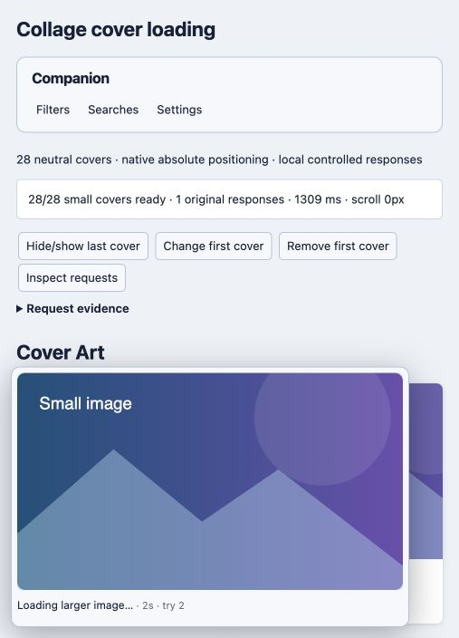

# Preview loading feedback

Version 2.8.1, October 23, 2026. Artifact SHA-256: `f0c7e94347decee31568c26ec10f08d5cdeeea1520f65778bafe211c62b323d5`.

The existing preview status line gains a subdued elapsed-time suffix after one second, such as “Loading larger image… · 2s”. Actual automatic retries add the scheduler’s attempt number: “· try 2”. No extra button, panel or setting is added. The thumbnail stays visible until the larger image succeeds.

Elapsed time describes this image request, including waiting for admission and automatic retries; it is not transferred bytes or an estimate of completion. A display copy of a page-owned image starts its own view-wait clock. Pinning the same request preserves its clock; switching requests or an explicit new Retry starts the appropriate new session. Unfinished partial images retain elapsed feedback until completion or dismissal.

Native image loading in this scheduler supplies load/error/state/dimension events, not downloaded/total byte counters. An actual percentage requires meaningful loaded and total values; progress-capable transports such as XMLHttpRequest expose them only when length is computable. [MDN ProgressEvent](https://developer.mozilla.org/en-US/docs/Web/API/ProgressEvent), [native image processing](https://html.spec.whatwg.org/multipage/images.html#processing-model). This change preserves the native image path, manager grants, host pacing, cache and success-only upgrade logic.

One timer refreshes the open, visible preview at most once per second. It performs no image requests, host probes, page scans or layout reads. Hidden documents suspend the timer; a still-loading pinned preview resumes it on return. Completion, failure, dismissal, target changes and disposal clean it up. Cached originals and ordinary title tooltips stay quiet. The numeric suffix is aria-hidden so it does not repeatedly update the live announcement text. Empty status paragraphs are explicitly hidden, avoiding a blank footer row now that status text has child spans.

Five focused regression checks cover elapsed/actual attempts, queued-to-loading/pin handoff, hidden/visible/close/dispose cleanup, cached/title/failure behavior, partial-image feedback and no extra image transfers or page scans. The full suite passes **192 checks**. Native local Chromium verified “Loading larger image… · 2s · try 2” above a 160px fallback, successful 960px display, pinned continuity, silent cached rehover and computed display:none on the empty status row. The fixture logs exactly two original requests: one injected 503 and one successful retry.

[JUnit](qa/2.8.1-full.xml), [native evidence](qa/preview-stats-281.json), [matrix](TEST-MATRIX.md). The underlying scheduler is byte-for-byte identical to 2.8.0, so the earlier 60-run host and 800-row CPU evidence is retained with its observed hash. This update did not reprofile total browser/decoder CPU or validate an actual Chrome/Tampermonkey sandbox.

To reproduce the native demo, run the local fixture server and open `/collage/277?qa=your-new-profile&retry-upgrade=1`. It uses neutral local small SVGs and a four-second original, with one controlled failure. A fresh profile avoids reusing an already-cached original. Normal loads use the existing current-source logic.

