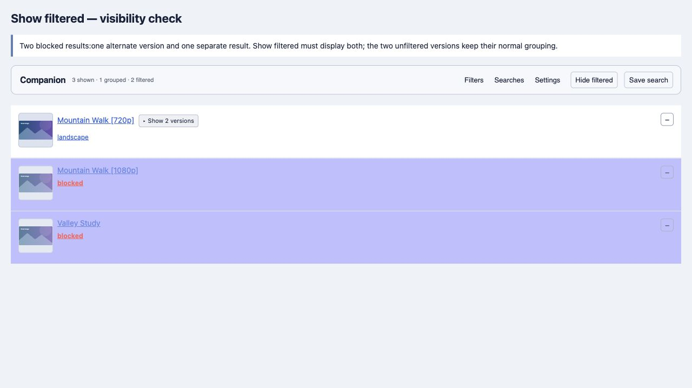
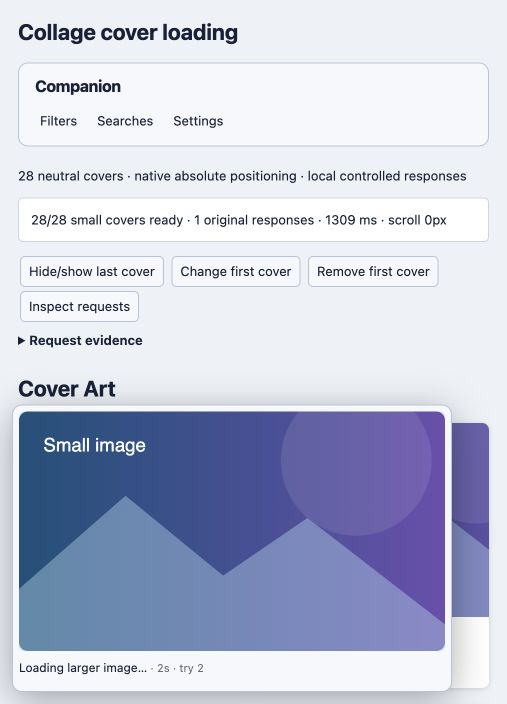
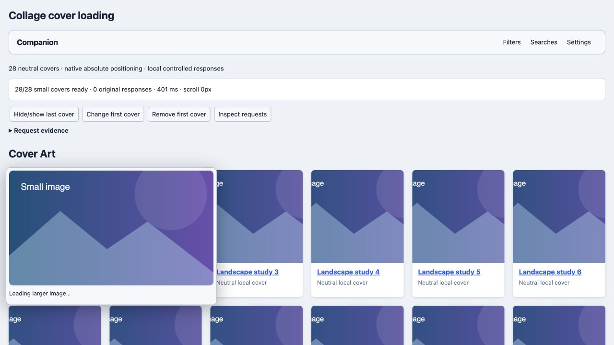
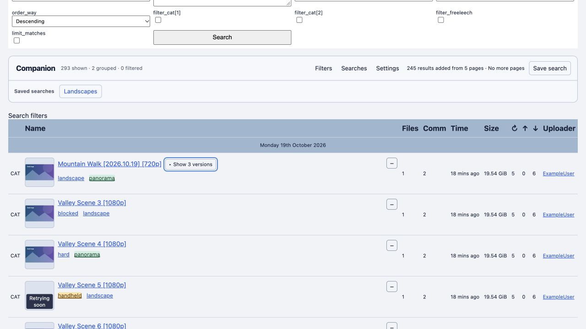
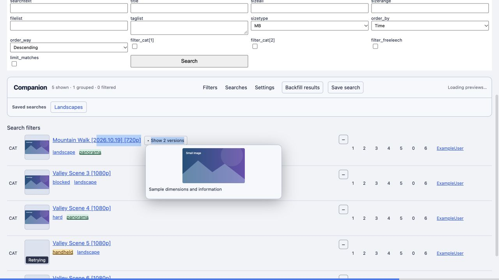
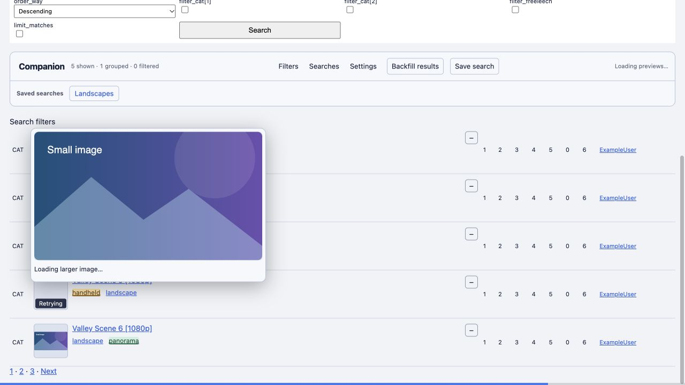
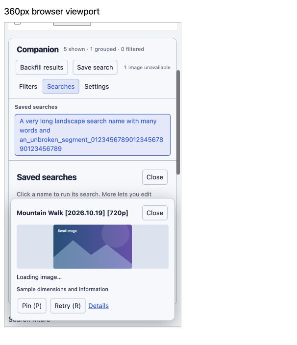

# Empornium Companion 2.13.3 validation

Updated November 6, 2026.

The build, syntax checks, and all **348 automated tests** pass. The scheduler regression verifies that one thumbnail can start beside an active original after the host cooldown. The cache statistics test covers pinning, live counter refresh outside Settings, persistence across pages, and unpinning. The stable and versioned userscripts are identical. Tested bundle SHA-256 is `40e607f425299c16d8bda6ea21b80c0e5874116ca27a95571d60a344c03a608f`.

In a local Chrome fixture, two uncached covers appeared in 48 ms and 75 ms after Load more while an original was still loading. Version 2.13.2 took about six seconds under the same simulated one-slot host limit. At a 360 px viewport, Chrome verified that the pinned cache table fit its panel, each of the six columns had a tooltip, the pin persisted across page navigation, and unpinning restored focus to Settings and persisted on reload.

---

# Empornium Companion 2.13.2 validation

Updated November 6, 2026.

The build, syntax checks, and all **346 automated tests** pass. The tests cover cached covers during a host cooldown, five-page collage pacing, and cache and HTTP diagnostic export. The stable and versioned userscripts are identical. Tested bundle SHA-256 is `b54b854017aa6be74ba38f015ca594bf1d13d455eb241b31f0818e110364eeef`.

Chrome used local collage fixtures with real IndexedDB and a test adapter for userscript-manager requests. A 300 px cover reused the saved 350 px resize with zero image requests, including when another tab held the statistics store. The run also verified the diagnostic events for HTTP 404 followed by a successful alternate, HTTP 403 followed by native loading, a blocked IndexedDB upgrade, and a browser policy that blocked displaying cached bytes.

---

# Empornium Companion 2.13.1 validation

Updated November 5, 2026.

The build, syntax checks, and all **338 automated tests** pass. The tests cover larger images that arrive before a thumbnail, after a thumbnail fails, and before switching from List to Grid. Chrome and Firefox reproduced the empty slot and hidden logo on the 2.13.0 build using a local fixture with a delayed thumbnail and simulated site styles. The same fixture showed the larger image in the slot and the logo in 2.13.1. Tested bundle SHA-256 is `194e04a7ae6ffbcf5f221958489635c0c433fb351c3006f24cc0b55d15583b37`.

---

# Empornium Companion 2.13.0 toolbar validation

Updated November 5, 2026.

The Compact menu keeps layout buttons and Load more in view. Browse options contains Freeleech and Show filtered, and a separate row holds saved searches and status. The toolbar, panels, filter menus, first-use setup, and image viewer use the same surface and control styles. The build and all **337 automated tests** pass.

Chrome and Firefox checked the compiled build on local fixtures. Browse options fit at 320, 390, and 736 pixels, close when you click outside, and return focus on Escape. The runs also checked saved shortcuts, switching layouts, conditional rules, seen and ignored history, selecting Freeleech, collage quick add, enlarging a grid image, and loading another results page. A selected theme carried through to Getting started and returning to the default restored the system appearance. Tested bundle SHA-256 is `d3b76d3fab5e15de5ad900daac996716ea1e5fa33229e3adb9b04309c646636d`.

---

# Empornium Companion 2.13.0 user audit

Updated November 5, 2026.

The build, syntax checks, and all **336 automated tests** pass. The stable and versioned userscripts are identical. SHA-256 for the tested build is `c7e2f8f18277b2f646547e1028a211f243f1bedfdf6a2b2efcb11945908ac2b8`.

Two Grid defects were reproduced and fixed. A header with a mix of ordinary labels and sort links now shows only the sort controls in Grid and restores the full header in List. An original image loaded in List remains usable when Grid replaces its inline image with a thumbnail. In Firefox, opening the larger image after a missing thumbnail could previously show a blank panel. Both fixes have regression tests that failed on the earlier build.

Chrome passed 15 user journeys and Firefox passed 14. The runs covered first use, Settings and keyboard navigation, narrow layout, image loading and failure, List and Grid, alternate versions, tag highlights, conditional rules and Hard Pass, Freeleech and Bookmarks, Seen & Ignored, saved searches, backup and restore, manual backfill and Stop, and collage covers and quick add. The browser harness delivered a simulated focus event for the cross-tab history refresh. Separate Chrome checks covered touch and automatic backfill. Automatic backfill finished all 260 results after two simulated HTTP 503 responses and kept request starts about one second apart during ordinary pagination. The 800-row performance fixture showed no idle scans or image-triggered regrouping, and recorded one long task when appending 50 rows.

Tampermonkey 5.5.1 in an isolated Chrome for Testing profile installed 2.12.3 and accepted 2.13.0 as an upgrade. The upgrade preserved a saved search and filter, and the build injected one toolbar per page. Its real image transport requested a thumbnail and larger image anonymously over local TLS, then reused both after reload with the image endpoint blocked. Firefox used the browser fixture's manager adapter. All application checks used loopback fixtures and dummy data.

---

# Empornium Companion 2.12.2 thumbnail validation

Updated November 5, 2026.

Companion starts once per document when the userscript is injected twice. In a local Chromium fixture, two isolated script contexts started before the page HTML loaded. All six result rows showed two thumbnails before the fix and one after it. The compiled-bundle regression checks for one thumbnail and one workspace. A grid regression verifies that a supported larger still image is saved as a preview and reused on a new page. Build, syntax checks and all 320 automated tests pass.

---

# Empornium Companion 2.12.1 compact grid validation

Updated November 3, 2026.

Grid titles now show at most two lines, with the full title retained in the link and hover preview. Tags, stats, uploader and category cells are hidden by default. Settings → Appearance has separate Show tags in grid cards and Show details in grid cards toggles, saved with the other preferences. Tag filters/highlights and List presentation are preserved.

The 318-check suite and updated 14 grid regressions pass, including the details/tags defaults, independent live toggles, compiled-bundle tag visibility, removal of grid annotations on returning to List, and persistence across pages/fresh storage sessions. Build and syntax checks pass. Native Chromium verified a long title at exactly two 21px lines at 1200px and 390px, hidden details by default, immediate restoration of stats/category cells, saved toggle state, and no grid overflow. [Compact grid evidence](qa/grid-2121-compact.png) shows the earlier tags-visible presentation. Browser validation used neutral local fixtures.

Card spacing was also checked with injected native row/cell minimum heights and trailing table line breaks. The grid overrides those heights, suppresses the extra breaks and removes title padding when details are hidden; the remaining bottom gap measured 16px at 1200px and 14px at 390px, with no narrow grid overflow. Returning to List restored the native sizing/break behavior. [Desktop spacing](qa/grid-2121-spacing-desktop.png) · [Narrow spacing](qa/grid-2121-spacing-mobile.png).

---

# Empornium Companion 2.12.0 grid validation

Updated November 3, 2026.

Version 2.12.0 adds List/Grid presentation, card-size presets and optional automatic larger images after the thumbnail pass. **318 automated checks pass**, including 14 grid checks. Build, syntax and source whitespace checks pass. The remembered layout and size survive different results pages and a newly constructed browser/storage session in the compiled-bundle regression.

Native Chromium verification used neutral local fixtures at 1200px and 390px: thumbnail-first loading, one transfer per automatically upgraded original, single-column narrow layout without overflow, preset autosave, layout/size persistence across page navigation, 16 native/backfilled rows retained as cards, and failure retention of the small image. Disabling upgrades in onboarding caused no automatic original requests; the existing small-image fallback remained available. The failure fixture intentionally returned image HTTP errors; it recorded no uncaught application errors.

Evidence: [desktop grid](qa/grid-2120-desktop.png), [narrow grid](qa/grid-2120-mobile.png), [size preset](qa/grid-2120-size-presets.png). [Behavior and limits](GRID-VIEW.md). These checks use local mock GM storage; live Empornium with Tampermonkey and actual browser restart remain manual checks. Generated stable, metadata and versioned 2.12.0 scripts are included together.

---

# Empornium Companion 2.11.0 quality audit

Updated October 30, 2026.

Version 2.11.0 enables collage backfill and reorganizes Settings. **301 automated checks pass.** Native checks cover manual/automatic collage loading, synchronized row/cover filtering/reveal, Settings autosave/search and narrow layout. The 101-scenario matrix retains historical/pending lanes; actual manager and native quota exhaustion remain unverified.

Final installable: `dist/EmporniumCompanion-2.11.0.user.js` (identical canonical copy).

SHA-256 (publication build): `e724228eb5e652416dfac6aaa9a2771a0fbade940c08b5816a0385f54ecc03d2`

## GitHub publication preparation, October 30, 2026

The publication build adds homepage, issue-report, source, update-metadata and stable-download URLs to the userscript header. The runtime after the metadata block is byte-for-byte identical to the previously audited 2.11.0 artifact (`46a746dc81d5b1413ab6d6500fb9a45be2dfb908ea4946cf8e07c3c39e39e059`); historical browser evidence continues to identify that artifact. The script name, namespace, grants, match rules and storage keys are unchanged.

The full 301-check automated suite and syntax checks pass after publication preparation. After correcting the publication URLs to match `mc-hamster/companion`, the final build, syntax checks and three focused bundle/publication checks also pass. The existing release regression additionally verifies the metadata-only file, stable/versioned equality, configured publication URLs and README install link. The README now documents installation and updates, and [publishing instructions](PUBLISHING.md) describe the first push and future releases. GitHub Actions is configured to build, check syntax, run tests, and reject stale or untracked generated release files. Public URLs and an actual Tampermonkey installation must be checked after the first push; they were not exercised by these local checks.


## Results and evidence

| Layer | Result | Scope |
| --- | --- | --- |
| Automated full suite | 301 passed, 0 failed | Source models, compiled bundle, strict JSON-cloned storage, failure injection, interaction and scheduling regressions |
| Acceptance scenarios | Focused rerun; remaining browser lanes pending | Earlier passes retained as history; see live matrix for current independent lane results |
| Browser lanes | Focused collage backfill/filter/reveal and Settings autosave/search/narrow checks; other lanes pending or blocked | Native Chromium with persistent mock GM storage; evidence records observed hashes and reviewed candidate observations |
| Syntax / build | Passed | All production modules and generated userscript; pinned vendor blob validation; deterministic rebuild |
| Chrome + Tampermonkey | Blocked / unverified | No connected installation in the user's Chrome profile |
| Firefox + userscript manager | Blocked / unverified | No connected Firefox environment |

The [test matrix](TEST-MATRIX.md) contains prerequisites, steps, expected behavior, independent lane results and evidence for every scenario. The side-panel progress view reads [qa-progress.json](qa-progress.json), which retains run history, defects and environment gaps.

Current JUnit result: [2.11.0 full suite,301 checks](qa/2.11.0-full.xml). Earlier2.10.6: [293 checks](qa/2.10.6-full.xml). Earlier2.10.5: [287 checks](qa/2.10.5-full.xml). Earlier2.10.4: [287 checks](qa/2.10.4-full.xml). Earlier2.10.3: [276 checks](qa/2.10.3-full.xml). Earlier2.10.2: [265 checks](qa/2.10.2-full.xml). Earlier2.10.1: [257 checks](qa/2.10.1-full.xml). Earlier2.10.0: [250 checks](qa/2.10.0-full.xml). Earlier2.9.2: [230 checks](qa/2.9.2-full.xml). Earlier2.9.1: [222 checks](qa/2.9.1-full.xml). Earlier2.9.0: [215 checks](qa/2.9.0-full.xml). Earlier2.8.3: [198 checks](qa/2.8.3-full.xml). Earlier 2.8.2: [195 checks](qa/2.8.2-full.xml). Earlier 2.8.1: [192 checks](qa/2.8.1-full.xml). Earlier 2.8.0: [187 checks](qa/2.8.0-full.xml). Earlier fixed-limit experiment: [175 checks](qa/concurrency-full-2026-10-23.xml). Earlier 2.7.7 result:[171 checks](qa/2.7.7-full.xml). Earlier results: [2.7.6](qa/2.7.6-full.xml), [2.7.5](qa/2.7.5-full.xml), [2.7.4](qa/2.7.4-full.xml); 2.7.3 stability [run 1](qa/final-stability-1.xml), [run 2](qa/final-stability-2.xml), [run 3](qa/final-stability-3.xml).

## Collage backfill and Settings usability, version 2.11.0

Backfill previously accepted only `/torrents.php` searches. It now accepts individual `/collage/<id>` pages while retaining the same origin, collage, sort/filter query and safe view action. It follows existing pagination rather than inventing links. Matching cover cards and rows append once per torrent ID. Safe generated SVG spacers preserve native sizing; fetched executable nodes, forms and arbitrary cover styles are removed. Cover image activation waits for the filter pass and remains under the shared small-first scheduler. A filter-processing failure rolls back both representations. Retry/Stop/background behavior uses the existing controller.

Settings previously presented a large diagnostics table ahead of buried everyday choices. It now groups Appearance and Browsing controls, moves hover/backfill/version choices to the main surface, hides page count in All mode, and keeps a compact cache summary. All metric windows, rates, savings, reset, cache policy and Clear saved images remain in one Statistics & storage disclosure. Statistics have no aging clock while folded. Top-level search spans common/advanced/cache/backup settings, opens matches and restores earlier disclosure state without saving. Controls are moved rather than duplicated, preserving preferences and autosave. The common select now uses its full width, and checkbox/tab order matches the visual layout.

Eight added regressions and the expanded existing suite total 301 passes. Native manual backfill adds two pages into six unique rows and six covers. Blocking the fixture tag hides three rows and three covers; Show filtered restores all six. Choosing All saves in place, hides page count, and automatically completes the collage after reload. Search reveals cache/advanced controls and returns to the compact view when cleared. The final 360px Settings pane has no internal overflow, with full selected-mode text visible. [Observations](qa/collage-settings-2110-browser.json), [Settings screenshot](qa/settings-2110.png), [narrow screenshot](qa/settings-2110-narrow.png), [backfill screenshot](qa/collage-backfill-2110.png). Initial candidate hashes remain identified; final automatic loading and Settings/narrow checks record the final artifact. Live-site inspection was read-only; actual manager installation is still unverified.

The local QA viewer also exposed a test-infrastructure issue: six duplicate live progress streams exhausted the browser's loopback connection slots. The fixture server now caps streams at two with a reconnect delay, and the viewer closes its stream while hidden. This change is absent from the production userscript.

## Estimated saved bandwidth, version 2.10.6

**Saved** sums known payload sizes per cache hit for each window. Numeric sizes follow successful decodes into memory and survive release of the Blob; saved-file and ready/shared memory reuse count. Downloads alone do not count as savings. Unknown sizes are excluded, using — or ≥ instead of invented historical totals. The card labels this as estimated reused image data because browser HTTP caching/coalescing and wire overhead cannot be measured. Schema 6 fences older writers while retaining files and prior metrics. No extra requests, image scans or timers are introduced.

Six added regressions plus expanded existing assertions cover known payloads, shared-memory reuse, download exclusion, persistence/concurrent writers, legacy sizes, expiry, abort/replay, failed bytes, reset/stale work and lower-bound UI. Native cold loads show 0 B; four saved-thumbnail hits show 2.0 KB. Another page reaches 3.9 KB, and original-preview memory reuse adds 509 B to reach 4.4 KB. Reset zeros every window on two pages and retains all 16 thumbnails plus the preview. At 360px the card is 286px and the table 268px with no internal overflow. [Browser evidence](qa/savings-2106-browser.json), [main screenshot](qa/savings-2106.png), [narrow screenshot](qa/savings-2106-narrow.png), [definitions and limits](PERSISTENT-CACHE.md#estimated-bandwidth-savings-version-2106). Current browser time-aging and storage fault injection rely on automated cases; older native controlled aging remains version-scoped below. Actual managers remain unverified.

## Hit rates, version 2.10.5

One column adds hits ÷ (hits + misses), excluding downloads and rounding to at most one decimal place. No lookups or incomplete pre-miss all-history data shows —. The latter retains the valid recent rates and explains the historical gap; reset clears every rate. The existing snapshot/aging path derives the values without new I/O or timers.

Expanded current UI regressions cover 62.5% and 72.7%, 0%/100%, empty/reset/aged windows, legacy gaps and no database polling. Native Chromium observes 0% recent activity at 0 hits/4 misses, 50% at 4/4 after reload, and all-history 66.7% at 8/4. Another page shows 75% at 12/4. Reset produces — in every row with 12 thumbnails retained. At 360px, the card remains 286px and the table 260px with readable column headers and no internal overflow. [Browser observations](qa/hit-rate-2105-browser.json), [main screenshot](qa/hit-rate-2105.png), [narrow screenshot](qa/hit-rate-2105-narrow.png). Earlier controlled time-window browser aging remains documented under 2.10.4; the current automated suite checks rate aging. Actual managers remain unverified.

## Cache misses and time windows, version 2.10.4

The existing cache card now contains one table: Hits, Misses, Downloads for 5 min, 15 min, 1 hour, All history. Missing/unusable managed lookup results count independently of successful transfers. Recent buckets persist across navigation and remain bounded to an hour; scalar totals remain until Reset stats. Schema 5 fences old writers while retaining saved files and old totals. The UI explains that pre-update misses/recent timestamps cannot be reconstructed. No new permission or setting is added.

Eleven new regressions cover independent windows, persistence/concurrent writers, legacy migration, 1,500-bucket retention, aborted journals, reset/stale work, miss scope/cancellation, compact rendering and local aging without database polling. The retention test caught a rollover bug before release. Dynamic-result fixtures now select torrent tables explicitly rather than the first table on a page; the existing mutation/filter/preview assertions pass with the Settings table present.

Native first load records four misses/four downloads; refresh adds four hits. Fixture clock controls advance only the controlled page's wall clock: 6 minutes zeros the 5-minute row, 16 minutes zeros 15 minutes, and 76 minutes zeros 1 hour. The all-history snapshot remains 12 hits/4 misses/4 downloads throughout. A reset clears every row on the clock page and another open page while eight saved thumbnails remain. Reload after reset adds four hits/zero misses/zero downloads. At 360px, the card is 286px and the table 260px, neither internally overflowing. [Native observations](qa/window-usage-2104-browser.json), [final screenshot](qa/window-usage-2104.png), [metric definitions](PERSISTENT-CACHE.md#misses-and-rolling-windows-version-2104). Initial observations identify their candidate hash; final-artifact refresh, clock, reset and narrow checks identify the final hash.

Other current-build browser lanes remain pending, with older evidence retained separately. Actual Chrome/Tampermonkey and Firefox are unverified.

## Cumulative cache usage and reset, version 2.10.3

Usage now survives navigation and refresh. The existing card contains one **Reset stats** button; it clears hit/download history without clearing image files. Clear saved images preserves history. Batched journal writes and atomic replay avoid lost tab increments or double counting after interrupted compaction. Reset generations and cross-tab notifications prevent pre-reset batches from returning. Schema 4 adds the journal without rescanning schema 3 image metadata. Counters begin with this version or the last reset and cover the same managed image activity as before.

Native Chromium with real IndexedDB and mock GM transport observes 0 hits/4 downloads initially, 4/4 after refresh, 0/0 after reset with all 4 thumbnails still saved, and 4/0 after another refresh. A second page reaches 8/0. Resetting that page updates both open cards to 0/0 with files unchanged. [Browser observations](qa/cumulative-usage-2103-browser.json), [screenshot](qa/cumulative-usage-2103.png). Eleven added automated regressions cover replay, concurrency, reset/clear separation, stale/in-flight work, failure recovery, coalescing and UI errors. Actual manager remains a separate environment gap.

## Cache usage, version2.10.2

The Settings card has two compact file/size rows, total/limit, and page-scoped activity. Files/bytes come from transactional role counters; hits include saved-byte and memory reuse, while downloads count successfully decoded manager payloads. Browser-native fallback traffic is excluded and the tooltip explains this. No periodic updates, Blob scan, new permission, reset button or configuration field is introduced. Local cache changes coalesce only while Settings is visible; stale results are ignored after switching/closing. A metadata-only schema3 upgrade reconstructs role counts.

Native reads9 saved thumbnails/4.4KB and1 preview/509B (10 unique files, shared across UI locations). Cold activity grows to5 downloads. After reload,4 saved hits/0 downloads grow to5 hits when the saved original is opened. Clear changes saved totals to0 without resetting5 page hits. The narrow card is286px with no horizontal overflow. [Native evidence](qa/cache-usage-2102-browser.json), [265-check suite](qa/2.10.2-full.xml), [metric definitions](PERSISTENT-CACHE.md#usage-summary-in-settings-version2102). Actual manager remains a separate pending environment.

## Thumbnail-first saved files, version2.10.1

Known thumbnail files up to512KiB are protected. Previews and larger files leave first under capacity pressure, even if more recently used. A low-priority newcomer that cannot fit around protected bytes is declined before evicting useful cached entries. Preview quota failures preserve thumbnails and leave their write path enabled. Budget reductions or thumbnail-only saturation can remove the oldest thumbnails as the last resort.

Metadata-only databasev2 migration retains existing Blobs, infers a conservative byte-based priority for legacy records, and adds an eviction index/protected-byte counter. Known thumbnail use is preserved when the same file is also a preview. Reads, writes, touches, removals and quota pruning maintain the counters transactionally; no additional polling or image requests are introduced.

Native migration restores8 existing thumbnails with the host blocked. A fixture-only3000-byte cap holds4 thumbnails plus a preview at2529 bytes. An oversized preview returns false with all entries intact. Adding a fifth thumbnail then removes the preview, leaving5 thumbnails/2525 protected bytes. [Native evidence](qa/thumbnail-priority-2101-browser.json), [policy](PERSISTENT-CACHE.md#thumbnail-first-policy-version2101), [257-check suite](qa/2.10.1-full.xml). Actual manager grants and real quota exhaustion remain pending.

## Persistent saved images, version2.10.0

The previous pool was page-local. Raising its memory allowance could not retain bytes after navigation/refresh. A separate IndexedDB layer now stores decoded-valid image files, metadata and byte/count statistics. No timed expiry applies to files. It defaults to512MB, with capacity/quota LRU cleanup and a50,000-file safety ceiling; the memory layer remains24 idle entries/48MP.

All managed inline/cover thumbnail locations participate. Public supported-host misses use one anonymous HTTPS blob request, then display a data URL and commit only after successful decoding. Hits use saved bytes without image HTTP. Static hover originals/fallbacks participate; large animated originals keep native streaming, and body/unknown/access-restricted images retain normal loading. The helper uses declared hosts rather than wildcard/cookie access. CSP/permission/storage problems do not disable ordinary images. Core logical URLs are separate from display data URLs, preserving correct preview status and source recovery.

Native real-IndexedDB tests show4 source thumbnails shared by8 UI locations plus1 larger preview. After navigation/refresh with image serving deliberately blocked,8 thumbnails render at160px and the preview at960px; server logs still contain only the original5 image requests. Clear saved images through Settings leaves0 bytes/count and8 visible images. A restrictive img-src policy results in8 native images and no application notice. Intermediate observations retain their hashes; final cache restoration is re-executed. [Browser evidence](qa/persistent-cache-2100-browser.json), [policy/limits](PERSISTENT-CACHE.md).

Unit coverage uses test-only fake-indexeddb6.2.5 for transaction/quota/concurrency faults. One scripted corrupt byte-cache entry falls back without charging a second attempt. New tests also cover anonymous HTTPS transport, declared permissions, late callbacks/abort errors, static original fallback after a missing small variant, non-BFCache request cancellation and variant-hint flushing before navigation. Quota exhaustion in a real browser and an actual Tampermonkey sandbox are not signed off.

## Retained preview originals, version2.9.2

Previously, unsubscribing the last interactive preview consumer canceled the request and erased its image source. Thumbnail previews now request retention. On last-viewer release the request drops to priority10 and discards hover/DOM eligibility closures. It continues within existing large-image and host limits, using normal retries. Rehover promotes the same entry to interactive priority. UI callbacks are removed, so completion while closed cannot reopen the popup or replace another image. Title-only temporary work remains cancellable.

Both unfinished retained requests and completed idle images count toward the existing cache-entry budget. Known dimensions enforce the idle megapixel budget; page/visible consumers are protected. LRU pressure can cancel older retained requests, refunding the in-flight attempt without penalizing hosts. Trimming pumps queued work only when a slot was freed; ordinary completed-image unsubscription adds no scheduler pass. Media-pool disposal still aborts unfinished work.

Native final-build collage checks show a4.003s original response after mouse-out, popup still closed, followed by immediate960px ready display with only one original request. Earlier candidate checks also verify inline-thumbnail reuse (one full request) and a503 followed by successful4.006s retry while closed; the final scheduling-only refinement is explicitly reviewed in the evidence. [Browser observations](qa/retained-hover-292-browser.json), [cache policy](HOVER-CACHE.md), [full suite](qa/2.9.2-full.xml).

Rendering checks retain zero idle scans and no image-update global regrouping. Group/tag interactive layout long tasks varied across two new runs and a2.9.1 control; the raw observations and limits are preserved rather than claiming every interaction is long-task-free. [Measurements](HOVER-CACHE.md#rendering-measurements).

## Backfill recovery, version2.9.1

The old loader stopped an entire All run on its first fetch/processing error and suppressed the reason. The screenshot plus toolbar message identify a partial failure, but not its original HTTP or JavaScript cause. Two read-only live-page inspections found ordinary50-row results/pagination; they do not establish the failing search's cause. No live stress test or torrent download was performed.

New bounded page recovery retries temporary failures twice at most, with2/4s base delay plus0–25% jitter. HTTP429 uses10/20s bases. Retry-After is a minimum, including HTTP dates. Successful added pages are separated by1s, requests remain serial, and Stop/background/disposal can cancel or pause the wait. Server cooldowns survive Stop/manual resume in the current session. Permanent/access/parse/processing errors stop immediately with a safe reason and Open page link. Exhaustion keeps the cursor and earlier rows, with no automatic restart from later scans/focus.

Native2.9.0 with injected503 reproduces150 retained rows and only51–100/101–150 marked included. Native2.9.1 reaches260 unique rows, all five remaining page links included, after503/503/success and429/success on page4. Measured retry intervals2.305/4.308s and12.501s (Retry-After12); normal gaps1.033–1.052s.403 stops after one failed request with explicit feedback. Stop during retry leaves150 rows and no further page request. [Timing and before/after evidence](qa/backfill-retry-291-browser.json), [222-check suite](qa/2.9.1-full.xml). This fixes the demonstrated transient-failure class; a persistent original failure will now expose its reason. Actual manager environments remain unverified.

## Getting started and automatic backfill, version2.9.0

First use displays an accessible native dialog with introductory text, Settings guidance and five concise configuration areas. Existing installations are prefilled; fresh setup suggests3 additional pages but starts nothing automatically before completion. Setup drafts commit through the existing transactional import path, including completion in the same rollback snapshot. Reopen from Settings, preserve custom widths and unrelated preferences/searches, cancel safely, or dismiss first use with Not now. Completion is installation-specific and is not copied into a backup.

N mode runs one batch on every supported torrent-list load; All follows Next through the remaining pages; manual retains the button. Filtering precedes thumbnail requests, HTML requests are serial, and image host pacing is unchanged. Background waits use one temporary visibility listener; Stop/dispose release it. Stop/errors never auto-restart. An admission-generation guard prevents Stop/dispose during the foreground await from starting a stale fetch. Append mutations are batched, with media scans limited to inserted rows.

Native tests validate all17 remaining pages (beyond the old15-page limit), successful3-page defaults, manual reload, custom88px preferences, replay, Stop, invalid input, sticky actions in a360px frame, keyboard containment, and storage failure/retry. The800-row check keeps zero idle scans/global regrouping for image updates and no steady-state long tasks; append50 retains one long task. Actual background transition behavior is model-tested, not a manager sign-off. [Browser evidence](qa/onboarding-290-browser.json), [CPU evidence](qa/performance-800-290.json).

A final file check found a stale2.8.3 canonical artifact after testing while2.9.0 source remained current. Rebuilding restored it. Builds now also emit a versioned installable; a regression checks its contents and metadata against the package and canonical tested artifact. Both final files were checked for matching SHA-256. The versioned file is the delivery link.

## Remaining Show filtered paths, version 2.8.3

The 2.8.2 grouping fix was incomplete. Its reveal CSS retained the native hidden class; a stronger theme selector still rendered the row display:none. Separately, removed Hard Pass rows were absent from the document, their collage cards stayed hidden, and an all-removed page had no usable reveal action. Three new compiled regressions fail before the fix. Native 2.8.2 confirms Hide filtered on the button while rows remain hidden and a removed card stays hidden.

Revealing now removes the native hiding class while preserving the filter identity attribute. Archived rows return at their existing position markers, use the shared thumbnail loader and stay outside collapsed groups. Hide removes them again; saved rules and archive identity remain intact. New rows honor the current reveal state. Summary/button state includes archived rows, including all-removed pages. Class updates are guarded and batched; no polling or new requests are added beyond thumbnails for explicitly revealed content.

Native 2.8.3 confirms both matching rows at display:table-row, all four cover cards visible with160px images, three repeat cycles without duplicate controls, all-removed pages, and rule edits while revealed. All198 checks pass. The800-row run retains zero idle scans and zero steady-state long tasks; append50 has one long task. [Prior failures](qa/show-filtered-remaining-before.xml), [browser evidence](qa/show-filtered-283-browser.json), [performance](qa/performance-800-283.json). This is local reproduction evidence; the actual user's theme and manager were not connected.

## Show filtered, version 2.8.2

Show filtered correctly added epc-revealed, but VersionGroups immediately included the row in a collapsed alternate-version group. The stronger version-hidden CSS rule kept it at display:none. The earlier reveal test asserted the class and button state; it missed actual visibility with a default collapsed group. A new regression reproduced the rendered failure before changing the code.

Explicitly revealed filtered rows now stay outside automatic version groups. Their thumbnails become eligible, while unfiltered versions retain grouping and expansion choices. Hide filtered restores rule-driven visibility without altering saved rules. New checks cover computed display, thumbnail admission, appended variants, live rule refresh, all-filtered cases and preserved expansion.

Native 2.8.1/fixed 2.8.2 comparison reproduces the blocked 1080p row hidden behind grouping and confirms both blocked rows visible with 160px thumbnail pixels after the fix. Hide/reveal cycles, live rule changes, showing all four filtered rows, hiding all four, and restoring previous group expansion pass. [Original failing suite](qa/show-filtered-before.xml), [browser data](qa/show-filtered-browser.json). Core host pacing and preview stats are unchanged; the 195-check full regression includes structural performance checks. Actual manager environments remain unverified.



## Quiet loading feedback, version 2.8.1

The existing preview status line shows subdued elapsed time after one second and the actual attempt number during retries. One visible-preview timer updates the suffix; it pauses when hidden and stops on completion/failure/dismissal/disposal. Cached originals and title tooltips stay quiet. The suffix is aria-hidden and an empty status row is explicitly hidden. It creates no image requests, page scans or new routine controls.

Five focused checks plus the full 192-check regression pass. Native local Chromium shows “Loading larger image… · 2s · try 2” while retaining 160px pixels; pinning preserves the suffix, successful 960px completion removes the entire row, and cached rehover remains quiet. Exactly two original requests correspond to one injected 503 and one successful retry. The host scheduler is byte-for-byte identical to 2.8.0; prior host/CPU browser evidence retains its original hash under source-impact review. Actual manager validation remains outstanding. [Design/limits](PREVIEW-STATS.md), [native data](qa/preview-stats-281.json).



## Adaptive host pacing, version 2.8.0

Automatic host limits grow with sustained good responses and back off independently on slowdown or errors. The bounded advisory history survives pages for 24 hours. Existing overall ceilings are preserved; there are no new routine controls. Constant-time counters replace repeated cached-entry scans. Background/interrupted timing and watchdog samples are excluded from learning; actual image errors still count.

The final 60-trial comparison loads 50/50 in every automatic run. Learned rate-limited runs have zero simulated 429s; fixed-eight runs have 15 per run and stop at 12/50 by 20 seconds. Unknown single-origin cold starts take 2.19s versus 1.56s fixed six, then 1.53s learned. Selected callback work is lower; full browser/decoder CPU is not measured. [Policy, data and limitations](ADAPTIVE-HOSTS.md).

Native collage loading is 623ms cold and 413ms learned for 28 small covers, with no originals before hover. Interrupted/re-entered previews retain small pixels, successful upgrades reach 960px, failures retain 160px, pin/Unpin and cover navigation work, and replaced/removed covers release their views. Fifty list thumbnails warm in 1432ms at scroll zero, retaining a ceiling of six; title tooltips remain usable. [Native UI evidence](qa/adaptive-ui-280.json).

The 800-row CPU run has zero idle scans, zero image-driven global regrouping and zero steady-state Long Tasks. Image-update rAF callbacks total 4.1ms; appending 50 rows retains one Long Task. [CPU evidence](qa/performance-800-280.json). Chrome/Tampermonkey, Firefox and live-host capacity remain unverified; all injected errors and timings used local neutral fixtures.

## Historical fixed-limit comparison (2.7.7), October 23

The [48-trial experiment](CONCURRENCY-EXPERIMENT.md) compares 6/8/12/16 small-image slots using native Chromium, 50 local PNGs per page and controlled healthy/slow/rate-limited origins. Higher settings help responsive multi-origin loads, but slow constrained origins and trigger simulated errors. Callback work increases; 16 adds no throughput over 12 in the responsive multi-origin case. The release artifact, default 6 and maximum 8 remain unchanged. Four additional scheduler tests retain request bounds and reserved hover capacity; 175 full-suite checks pass. No live-host traffic or actual Tampermonkey validation was performed. Detailed methods, timing tables, CPU limits and raw evidence are linked from the experiment report.

## Collage Cover Art, version 2.7.7

Read-only inspection found 28 empty cover DIVs with inline original-image CSS backgrounds, including large GIFs and legacy 300px resize URLs. The browser can start those originals before normal recovery runs. An early CSS gate suppresses their eager backgrounds while retaining the source for restoration. Small image nodes use the shared six-slot thumbnail queue across the current page, including offscreen cards; hidden cards wait until revealed. Provided small variants are preferred and legacy 300px sources remain in the small lane. Failed thumbnails use bounded original fallback and the full-image timeout.

Hover shows small pixels with “Loading larger image…” and replaces them only after a successful original load. Failure retains the small image with explicit feedback. Moving away dismisses the enlargement; cached rehover reuses the loaded original, and clicking it pins existing controls. Cover links navigate normally. Native absolute positioning is preserved. The browser fixture caught a zero-size enclosing anchor that initially dismissed hover on pointer movement; geometry now follows the visible cover. Covered neighboring links cannot steal an enlargement.

The final neutral native-shaped fixture loaded 28/28 small covers in 401ms at scroll zero with no originals before hover. The preserved 2.7.6 bundle requested 28 original CSS backgrounds. Local responses use 60ms small images and 2.2-second originals with no-store headers. This verifies request choice and queue progression, not live-host latency. Native checks cover successful 160→960px upgrades, four leave/return cycles, one request for the first original across cached rehover, failed larger-image retention, pin/Unpin, normal cover navigation, hidden reveal, source replacement, removal and toggling recovery/previews. Small-source fallback and background-tab eligibility branches have automated coverage. [Raw evidence](qa/collage-covers-277.json).



The 800-row CPU regression retains zero idle scans, zero global regrouping during image updates, and zero steady-state long tasks. Image-update animation-frame callbacks total 3.6ms. A 50-row append still has one long task. [CPU evidence](qa/performance-800-277.json). No periodic cover scan was added. Early suppression depends on document-start execution; requests already started before late manager injection cannot be undone. Actual Chrome/Tampermonkey timing and CSP remain unverified.

## Backfill columns, version 2.7.6

The native Name header carries `width="100%"`. After backfill crossed 200 rows, Companion's fixed-column optimization combined that hint with percentage column widths. This made Files, Comm and Uploader narrower than their own labels. The earlier browser fixtures lacked native headers and did not expose this conflict.

The new layout keeps measured metadata widths in pixels and lets Name take the remaining space. A scoped CSS rule neutralizes cell width hints only while Companion owns the layout; original attributes remain untouched. A minimum readable width prevents metadata labels from being squeezed by a narrow container. Native layout is restored during a backfill batch, then measured once at completion or Stop, including newly longer values. No resize polling or steady-state table scans are added.

The native-header fixture reproduced the failure at 295 rows: Files had 34px for 41px of content, Comm 45px for 55px, and Uploader 60px for 76px. The correction retained their natural widths of about 46/60/81px. All labels fit after resizing the table 1244 → 720 → 1244px. Stop kept 295 rows readable; resume reached 540 rows and expanded Time from 72.77px to 122.02px for longer dates. Category removal preserved a two-column Name span; disabling grouping removed owned columns/minimum width and restored the native percentage hint. Native colgroup preservation and hidden-category/batch lifecycle behavior are also covered by model tests.

Evidence: [failure measurements](qa/backfill-columns-before.json), [corrected geometry](qa/backfill-columns-after.json), [Stop/resume/category lifecycle](qa/backfill-columns-lifecycle.json). Very narrow layouts retain a minimum readable table width rather than compressing labels into adjacent columns.



The final 800-row run retained zero idle scans, zero global regrouping during image updates, and zero long tasks during image updates, scrolling, group toggles and highlighting. Image-update animation-frame callbacks totaled 4.0ms. Appending 50 rows still produced one long task. [Current raw CPU results](qa/performance-800-276.json).

## Title interactions, version 2.7.5

Title mouseover now shows an informational tooltip near the pointer, using the row's existing thumbnail and metadata. Mouse-out closes it immediately, even if the title is focused. Title focus and clicks behave as ordinary links; no preview controls or extra original-image request come from hovering a ready-thumbnail title. Layouts without inline thumbnails use the same small-first request options and cancellation logic. Hovering/clicking the thumbnail retains the larger-image upgrade and pinned controls.

Titles keep the browser's right-click menu. Title phrase rules remain under Filters → Title rules, with explanatory text; the obsolete title-menu toggle is removed from the visible interface. Stored rule lists and legacy import values remain compatible. Tag and uploader menus stay attached to those specific values.

Five new tests cover ordinary focus/navigation, transient tooltips, shared loading, title-only layouts, title/thumbnail transitions, cancellation before the hover delay expires, queued ownership across preference changes, and native menus with live phrase filtering. Native Chromium also exercised backfilled rows, title navigation, tag/uploader menus and no-inline layouts. [Browser evidence](qa/title-interactions-275.json), [original failed requirements](qa/title-interactions-before.xml), [pending-hover race](qa/title-context-delay-before.xml).



## Hover upgrade, version 2.7.4

A ready thumbnail remains visible with “Loading larger image…” while the original loads. Partial pixels do not replace it. Successful detached images are displayed directly from memory, with no extra URL assignment; a failed larger image leaves the thumbnail and a clear status. Page-owned images remain in place, and failed or stale display copies cannot replace the preview.

Three new regressions cover success-only upgrade/failure, exact loaded-node reuse through Retry/hide/rehover, and shared native-target ownership/stale completions. Native Chromium verified a 160px thumbnail becoming a 960px original only after success, one original request across swap and cached rehover despite no-store headers, permanent failure retaining 160px pixels, pinning during load, Retry retaining the 960px image, eight immediate rehovers and five originals under cache pressure. [Raw browser evidence](qa/hover-upgrade-274.json), [rapid/cache regressions](qa/hover-274-regressions.json), [original failing tests](qa/hover-upgrade-before.xml).



## Defects reproduced and fixed

| ID | Observed failure | Fix and verification |
| --- | --- | --- |
| QA-01 | A later preference write failed after earlier filter writes had already committed. | Snapshot/rollback across preference keys; failed draft remains retryable. Strict-storage partial-write regression passes. |
| QA-02 | Failed search saves could escape event handlers or publish an unwritten library. | Persist before publishing changes; retain rename drafts, original records and deletion Undo on error. Native save/rename/delete/Undo failure-and-retry flows pass. |
| QA-03 | Removing a hovered row left an orphan preview. | Forget removed origins; close transient preview immediately while retaining pinned metadata and working controls. Native scheduled removal checks pass. |
| QA-04 | Removed rows retained preview bindings and unowned transfer work. | Release bindings, obsolete table-layout references, queued/active transfers and tag-index nodes. Ten batches containing 100 inserted/removed results returned DOM-owning maps, queue and active transfers to baseline. |
| QA-05 | Clicking Unpin immediately pinned the preview again. | Scope click-to-pin to the image frame so action clicks do not bubble into it. Actual Unpin button regression and native test pass. |
| QA-06 | A transient keyboard preview could intercept a quick click into another tool. | Dismiss transient preview on outside pointerdown. Regression and native focus → Searches → More → Rename flow pass. |
| QA-07 | Repeated successful image loads after cache eviction eventually exhausted the failure budget. | Successful completion resets the failure streak while retaining manual/rescue guards. Six-cycle model regression, 15-load candidate browser check and 10-load final-artifact eviction check pass. |
| QA-08 | A fallback original inherited the short small-image timeout; supplied thumbnail URLs without a filename suffix were misclassified. | Track explicit small candidates, give originals the large lane and full-image deadline. A 503 small source followed by a 2.2-second original now succeeds with a 1.5-second small deadline and 4-second original deadline. |
| QA-10 | Backfill squeezed native header columns after the large-table optimization activated. | Neutralize the native 100% Name hint within the owned layout, keep metadata widths readable, flex Name, and measure each completed/stopped batch once. Native 295/540-row and resize/span checks pass. |
| QA-11 | Absolutely positioned cover art sits in a zero-size link; link-based geometry dismissed hover during pointer movement. | Use visible cover bounds for containment and positioning; preserve native absolute layout. Regression and native loading/leave/rehover checks pass. Covered neighboring links cannot steal the enlargement. |
| QA-12 | Background time or delayed watchdog expiry penalized a healthy image host. | Exclude interrupted timing from learning while still reacting to real load errors. Two reproduced failures are preserved in [candidate background checks](qa/adaptive-background-before.xml); current regressions pass. |
| QA-13 | Show filtered reveals an alternate version, then automatic grouping hides it again. | Keep explicitly revealed rows outside automatic groups; verify computed visibility and thumbnail admission, not just classes. Native before/after, rule refresh and expansion restoration pass. |

Preserved failures: [initial acceptance checks](qa/first-acceptance-failures.xml), [Unpin](qa/unpin-button-before.xml), [outside-preview click](qa/outside-preview-before.xml), [cache pressure](qa/cache-pressure-before.xml), [fallback deadline/lane](qa/fallback-before.xml).

The audit also corrected weaknesses in the tests: reference-sharing storage was replaced with JSON-cloned persistence for new acceptance checks; startup assertions wait for functional readiness; hover CPU counters begin after startup frames settle. These changes distinguish product failures from fixture timing errors.

## Browser sessions

The browser fixture persists separate named profiles across reloads and tabs. Tests exercise actual GET navigation, native pointer/keyboard input, file-input/FileReader restore, controlled image responses and one-time storage/page failures. Export captures the local test Blob without downloading a file.

Verified workflows include:

- Eight rapid hover/leave/return cycles with a usable image on every return; target switching; original completion and cache reuse; cache eviction; pin, actual Unpin, Retry, Escape and removed-origin behavior.
- Failed small-image fallback, bounded permanent failure, deferred gallery reveal, changed gallery/cover sources, and 50 thumbnails completing without scrolling.
- Live block/allow/Hard Pass precedence; removal/restoration and reveal; contextual highlighting on appended rows; expanded version groups retaining original rows and promoting a new representative.
- Complete saved criteria, direct reload, contextual edit/Cancel/Save, same-record cross-tab conflicts, unrelated-record merging, rename/delete/Undo and failed writes.
- Backup round-trip, preference persistence, Undo preserving a newer search, empty-profile initialization, and a genuine older 2.7.0 bundle upgrading to 2.7.3.
- Narrow 360-pixel layout with a long saved name; 800-row table expansion, 560 → 360 → 560 resize, category removal and disabling grouping restoring all 800 rows.

Evidence: [final hover cycles](qa/hover-release-final.json), [backup data round-trip](qa/backup-roundtrip.json), [older-bundle upgrade](qa/upgrade.json), [final thumbnail warming](qa/thumbnail-warming-release-final.json).



Browser evidence is scoped, not exhaustive. Case notes disclose branches exercised only by automation, including physical touch behavior, legacy-reset confirmation, some status/detail-page permutations and restoration of focus. After the last two image fixes, unchanged UI/filter/search checks were carried forward using source impact review rather than silently relabeling them as new executions. Their observed artifact hashes remain in the progress JSON. The final image/hover regressions were rerun separately.

## Performance

The 2.7.3 image-loading artifact prepared **50/50 thumbnails in 1,110 ms at scroll offset zero**, using local 100 ms small-image responses and no-store headers. This verifies automatic queue progression; it does not predict live image-host latency.

The 800-row / 16,000-tag CPU check, performed before the isolated final thumbnail lane/deadline change with inline image work disabled, measured:

| Workload | Result |
| --- | --- |
| 30 native image updates | 5.3 ms total animation-frame callbacks, zero global regrouping, zero long tasks |
| 30 scroll steps | 1.4 ms callback total, zero long tasks |
| 10 group toggles | Zero global regrouping, zero long tasks |
| Six highlight changes | 18.5 ms total tag refresh, maximum 3.2 ms |
| Idle before/after | Zero result/media/tag scans |
| Append 50 rows | One long task; largest callback 65.5 ms |

[Raw 800-row results](qa/performance-800-final.json). Timings are instrumented wall times, not whole-browser CPU percentages. Cold initialization and large insertions remain heavier than steady-state operation. The removal tests check structural ownership; this audit did not capture a full browser heap profile.

## Remaining limits

The actual Chrome/Tampermonkey sandbox and Firefox remain untested. Manager grants, isolation, live CSP behavior and production-site markup need a separate installation smoke test. No userscript was installed or updated in the user's Chrome profile during this audit.

The local fixture uses neutral images and synthetic criteria, not a production search backend. Its IP-address origin also differs from the engine's production hostname assumptions, so per-torrent ID/reset semantics rely on automated fixtures using Empornium URLs. Physical touch hardware, every theme, every detail-page layout and account notification submission were not exhaustively exercised.

No torrent downloads, production account changes, external uploads or third-party script execution were performed. All storage mutations and injected failures affected disposable local test profiles.

## Reproduce

```sh
pnpm build
pnpm check
node --test --test-reporter=junit test/*.test.mjs > /tmp/ep-qa.xml
node scripts/qa-progress.mjs junit /tmp/ep-qa.xml "Local regression run"
pnpm fixture
```

Open `/qa-progress` for the live matrix, `/collage/277?qa=your-cover-profile` for neutral cover cards (optional `fail-large=1` or `hidden=1`), `/torrents.php?qa=your-test-profile` for persistent acceptance sessions, `/torrents.php?bench=ahead` for no-scroll warming, `/torrents.php?cpu-bench=1&rows=800` for CPU checks, and `/qa-resize` for the large-table viewport check. These routes are local test infrastructure and are absent from the release userscript. The genuine old-bundle comparison additionally requires the preserved 2.7.0 artifact at the path documented in [PERFORMANCE.md](PERFORMANCE.md).

The cover comparison additionally uses `baseline=1` and a preserved 2.7.6 bundle at `/tmp/ep-companion-2.7.6-baseline.js`.
