# Validation

Version 2.11.0 passes 301 checks. Eight new cases cover collage URL identity, deduplicated row/cover appends, filter-gated image activation/reveal, safe cover sizing/sanitization and rollback, automatic collage loading with retry, common Settings structure, in-context backfill autosave, and global search/disclosure restoration. Existing interface assertions were updated for six common preferences plus search; metric tests explicitly open the collapsed detail section.

Read-only inspection of the supplied live collage confirmed the pretty URL, 50-row table, paired grid cards, native SVG spacer and `#discog_table` pagination anchor. Native neutral fixtures load two extra pages into six unique rows/covers, hide/reveal both together, persist All mode and load automatically on refresh. Final Settings displays full labels at 360px, hides irrelevant page count, and restores folded cache/advanced details after search. Final cached reloads show no image requests. [Suite](qa/2.11.0-full.xml), [browser observations](qa/collage-settings-2110-browser.json), [Settings](qa/settings-2110.png), [collage](qa/collage-backfill-2110.png). Actual Tampermonkey remains unverified; no production-site mutation or torrent download occurred.

Version 2.10.6 passes 293 checks. Six new regressions cover actual payload sizes from decoded disk and shared memory hits; cross-page/two-tab saved-byte totals and aging; migration of older unknown sizes; aborted journal replay/clear/reset/stale-tab behavior; invalid or failed image sizes; and UI values, lower bounds and empty reset windows. Existing managed-download and rolling UI tests now assert byte accounting and aging without polling.

Native Chromium records 0 B saved on cold downloads, 2.0 KB after four saved-thumbnail hits and 3.9 KB after four further hits on another page. Reusing a loaded original preview adds its 509 B, giving 4.4 KB. Reset clears every savings window on both open pages while retaining 16 thumbnails and one preview. At 360px, the 286px card contains a 268px six-column table without internal overflow. [Suite](qa/2.10.6-full.xml), [browser evidence](qa/savings-2106-browser.json), [screenshot](qa/savings-2106.png). Actual managers remain unverified.

Version 2.10.5 passes 287 checks. Existing cache UI tests now verify per-window percentages, 0%/100%, rounding, exclusion of downloads, empty/reset/aged-out windows, legacy-history gaps and unchanged no-polling behavior. Native Chromium confirms 0% on cold recent activity, 50% after four cached reuses, 66.7% for all history at 8 hits/4 misses, and — after reset. The 260px table fits within the 286px card in a 360px frame. [Suite](qa/2.10.5-full.xml), [browser evidence](qa/hit-rate-2105-browser.json), [screenshot](qa/hit-rate-2105.png). Actual managers remain unverified.

Version 2.10.4 passes 287 checks. Eleven added cases cover missing/failed/unsupported/bypassed lookups, rolling boundaries and future timestamps, cross-page/two-tab windows, schema 4 history preservation, bounded retention over 1,500 buckets, abort/replay timestamps, all-window reset, canceled/unusable reads, the four-row UI, aging without database reads, and unavailable/legacy states. A long-run case caught and fixed a bucket rollover accounting defect. Existing dynamic-row tests now explicitly target torrent tables so the new Settings table cannot become their insertion/removal target.

Native Chromium shows four misses/four downloads on first load and adds four hits on refresh. A controlled clock ages the 5-minute, 15-minute and 1-hour rows independently while retaining all-history totals. Reset clears all rows in two open pages, preserves eight saved thumbnails, and refresh then adds four hits with zero misses/downloads. The 286px card and 260px table fit a 360px frame without internal horizontal overflow. [Suite](qa/2.10.4-full.xml), [browser observations](qa/window-usage-2104-browser.json), [Settings screenshot](qa/window-usage-2104.png). Actual Chrome/Tampermonkey and Firefox remain unverified.

Version 2.10.3 passes 276 checks. Eleven additional tests cover journal replay after interrupted navigation/compaction, two-tab atomic accumulation, duplicate prevention, separate Clear/reset behavior, reset during an in-flight batch, stale-tab epochs/notifications, failed writes/reset recovery, burst batching without idle timers, and reset UI success/failure. Native Chromium observes 0 hits/4 downloads → refresh 4 hits/4 downloads → reset 0/0 with all four thumbnails intact → refresh 4/0. A second page reaches 8/0; resetting there updates both open Settings cards to 0/0. [Suite](qa/2.10.3-full.xml), [browser observations](qa/cumulative-usage-2103-browser.json). Actual Chrome/Tampermonkey and Firefox remain unverified.

Version2.10.2 passes265 checks. Eight additions verify per-role file/byte summaries without reading image Blobs; replacement/reclassification/prune/remove/clear accounting; successful managed download, saved-byte and memory hit activity; v2 counter migration; compact UI/formatting; visible-update coalescing/clear; stale-read cancellation and unavailable storage. Native Settings reads9 thumbnails/1 preview, observes5 downloads on the cold page, then4→5 saved-cache hits with0 downloads after reload/preview reuse. Clear reaches0 saved counts/bytes while keeping this-page activity; a286px card has no horizontal overflow. [Suite](qa/2.10.2-full.xml), [browser evidence](qa/cache-usage-2102-browser.json). Actual manager environment remains unverified.

Version2.10.1 passes257 checks. Seven new priority regressions cover newer-preview eviction before older thumbnails, safe large-entry rejection, overlarge thumbnail classification, preview-quota isolation, shared thumbnail/preview role tracking, budget reduction and in-placev1 migration. Native real-IndexedDB testing preserves8 old thumbnails with the host blocked. With a fixture-only3000-byte limit, a large admission is rejected while4 thumbnails and the existing preview survive; adding a fifth small thumbnail then removes the preview and keeps all5 thumbnails. [Suite](qa/2.10.1-full.xml), [native evidence](qa/thumbnail-priority-2101-browser.json). Real browser quota exhaustion and actual Tampermonkey remain unverified.

Version2.10.0 passes250 checks. Twenty additions cover actual-byte persistence/reopening without expiry, one network miss/local reuse, LRU/replacement accounting, concurrent writers, quota recovery, clear/in-flight generation guards, storage/permission/native fallback, cancellation/late callbacks, corrupt saved bytes, cache-hit host timing, HTTPS-only transport, metadata permissions, missing-small/static fallback, navigation cleanup/BFCache, and immediate variant-hint flushing. Native real-IndexedDB tests retain all8 inline/cover images plus a960px preview across navigation and refresh with the image host blocked: only the original4 small requests and1 original request appear. Settings clearing reaches0 saved bytes while8 images stay visible; CSP-denied data URLs fall back to8 ordinary images. [Suite](qa/2.10.0-full.xml), [native observations](qa/persistent-cache-2100-browser.json). Actual manager grants/sandbox and real browser quota exhaustion remain unverified.

Version2.9.2 passes230 checks, adding eight retained-hover cases for same-transfer reuse/demotion, bounded offscreen retries and visibility, foreground queue priority,40-item sweeps/cache pressure, live-consumer and megapixel behavior, shared requests/disposal, and stale-popup protection/no page scans. Existing cancellation-based hover expectations now assert continuation and no extra transfers. Native list and collage checks confirm closed completion and960px rehover with one original request; an injected first failure retries while closed and is then reused. [Full suite](qa/2.9.2-full.xml), [native observations](qa/retained-hover-292-browser.json), [performance results](qa/performance-800-292.json), [design/scope](HOVER-CACHE.md).

Version2.9.1 passes222 checks. Seven additional regressions cover a six-page/260-row page4 failure/recovery, exact request order and serial operation, increasing delay, Retry-After seconds/date, exhaustion/manual cursor resume, permanent/access/processing failures, Stop during backoff, foreground gating after a retry deadline, and preserved server cooldown on Stop. Native old/new comparison reproduces two included pages plus a generic page4 failure on2.9.0;2.9.1 completes all260 rows after two503s and after a429. Actual waits are2.305/4.308s for503 and12.501s for a12s server instruction; normal page gaps exceed1s. Permanent403 stops after one request and exposes a safe reason/link. [Suite](qa/2.9.1-full.xml), [browser timing/evidence](qa/backfill-retry-291-browser.json). The actual user's original HTTP/processing error was not captured by2.9.0.

Version 2.9.0 passes215 checks, adding first-use/replay/dismissal, custom preferences/search preservation, invalid input, transactional write-failure rollback, live tags, hidden first use, N/all automatic modes, beyond15 pages, serial requests, background/Stop/error/disposal handling, backup compatibility, append scan scope, and release metadata checks. Native Chromium checks cover setup, Settings replay, all17 remaining pages, Stop, manual reloads, custom88px preferences, keyboard containment,360px layout, invalid input and a failed GM write followed by retry. [Full suite](qa/2.9.0-full.xml), [native observations](qa/onboarding-290-browser.json), [800-row CPU check](qa/performance-800-290.json). Background transitions are deterministic model tests; actual manager environments remain unverified.

Version 2.8.3 adds three regressions that fail on 2.8.2: stronger native theme hiding, restoration of removed rows/cards, and all-removed pages with live rule changes. The full suite passes 198 checks. Native old/fixed comparisons confirm actual rendered rows and 160px thumbnails in both list and collage, plus three hide/reveal cycles and rule edits without duplicate controls. The 800-row check has zero idle scans and no steady-state long tasks; appending50 retains one long task. [Full suite](qa/2.8.3-full.xml), [prior failures](qa/show-filtered-remaining-before.xml), [native evidence](qa/show-filtered-283-browser.json), [performance](qa/performance-800-283.json). Other current-build browser lanes are pending and retain historical evidence; actual Chrome/Tampermonkey remains unverified.

Version 2.8.2, validation updated October 23, 2026.

195 automated checks pass with Node.js 24.19.0 and jsdom 26.1.0. The preceding 2.7.3 audit passed 152 checks in three consecutive runs. Syntax checks cover source modules and the generated userscript. The build verifies the pinned upstream and mc-hamster-fork Git blobs before transformation.

The quality audit has a [82-scenario matrix](TEST-MATRIX.md), [defect report and environment limitations](QA-REPORT.md), persistent browser profiles, controlled request/storage failures, and preserved failing/passing JUnit evidence. Of the scenarios, 80 pass within the documented local coverage; actual Chrome/Tampermonkey and Firefox validation remain blocked. Browser evidence records the observed artifact and any explicitly reviewed carry-forward to the final artifact. The historical checks below retain their original version scope.

Version 2.8.2 adds three Show filtered/version regressions. The earlier class-only reveal assertion missed a collapsed-group display:none override. New compiled checks assert actual computed visibility, thumbnail src admission, append/rule-refresh persistence, and unfiltered-group expansion restoration. Native old-bundle/fixed-bundle comparison confirms both filtered rows visible with rendered 160px thumbnails; hide, all-filtered pages and live rule changes work. [Current 195-check suite](qa/2.8.2-full.xml), [original failure](qa/show-filtered-before.xml), [browser evidence](qa/show-filtered-browser.json).

Version 2.8.1 adds five loading-stat regressions: queued/active/retry elapsed time, pin continuity, hidden/visible/close/dispose cleanup, partial/cache/title/failure behavior, no added image transfers or page scans, and removal of the empty status row. Native controlled-retry checks validate the visible suffix and exactly two original requests. [Current 192-check suite](qa/2.8.1-full.xml), [native evidence](qa/preview-stats-281.json), [design/limits](PREVIEW-STATS.md).

Version 2.8.0 adds twelve host-pacing regressions for growth, slowdown/stale completions, local backoff and wakeups, fallback destinations, cancellation, constrained lane sharing, reserved hover capacity, partial/cache/background samples, live ceilings, bounded/expiring history, failed persistence and sustained serial-RTT recovery. The 60-trial native comparison loads 50/50 in every automatic run, including constrained hosts; learned rate-limited runs have zero simulated errors. The 800-row pass retains zero idle scans and steady-state long tasks. [Policy/methods](ADAPTIVE-HOSTS.md), [current 187-check suite](qa/2.8.0-full.xml), [native UI](qa/adaptive-ui-280.json), [CPU](qa/performance-800-280.json).

Version 2.7.7 adds nine collage regressions: six-slot small-image warming across 28 cards, legacy resized sources, failed-thumbnail full-image deadline/lane, success-only hover upgrades, native link navigation, hidden/foreground queuing, replacement/removal/disable cleanup, absolute positioning and zero-size-anchor/overlapping-card pointer geometry. A native-shaped Chromium fixture loaded 28/28 small covers in 401ms at scroll zero with no originals before hover; the 2.7.6 comparison requested 28 original backgrounds. Controlled responses are 60ms small and 2.2s original, with no-store headers; this is not a live-host latency estimate. Native failure/reveal/replacement/preference checks and the 800-row CPU regression are recorded in [cover evidence](qa/collage-covers-277.json), [CPU evidence](qa/performance-800-277.json) and the [full suite](qa/2.7.7-full.xml).

Version 2.7.6 reproduces native Name width=100% headers squeezing other columns after backfill crosses 200 rows. New model tests cover hidden-category/title spans, metadata pixel widths/flexible Name, batch-end remeasurement, Stop restoration and cleanup. Native Chromium verified 50→295→540 results,1244→720→1244 widths, longer Time values, category removal and native restoration with every heading fitting. The 800-row performance pass has zero idle scans and zero steady-state long tasks; a 50-row append retains one long task. [Native before/after](qa/backfill-columns-after.json), [lifecycle](qa/backfill-columns-lifecycle.json), [CPU](qa/performance-800-276.json), [full suite](qa/2.7.6-full.xml).

Version 2.7.5 adds five tests for conventional title focus/navigation, shared-thumbnail informational tooltips and immediate dismissal, cancellation of delayed hover on native right-click, title-only small-first loading, title/thumbnail handoff, queued loading across preference changes, and native title menus with phrase rules retained in Filters. Native Chromium checks include backfilled rows, ordinary title navigation, live title filtering, unaffected tag/uploader menus, and no original-image requests from ready-thumbnail title tooltips. [Evidence](qa/title-interactions-275.json), [full suite](qa/2.7.5-full.xml).

Version 2.7.4 adds three hover-upgrade regressions: partial/failing originals retain the thumbnail; successful detached images are moved into the preview without another transfer and remain usable through retry/cache reuse; shared page images stay in place while failed/stale display copies cannot replace the current image. Native Chromium verified 160px→960px only after success, explicit loading/failure status, one original request through swap/rehover, pin during load, retained pixels on Retry, eight rapid rehovers and five originals with cache eviction. [Browser evidence](qa/hover-upgrade-274.json), [full 155-test result](qa/2.7.4-full.xml).

Coverage includes URL/download guards, overlay parsing, restricted fallback, query preservation, queue priority, deduplication, retry budgets, no-event stalls, first-frame display, force retry, circuit-breaker wakeup, cache eviction, hidden galleries, old-source races, offscreen recovery, changing covers, dynamic rows, keyboard controls, complete saved searches, legacy migration, imports/rollback, NSE filtering precedence, status/uploader filters, reset isolation, context menus and HTML escaping.

Version 1 exercised the baseline recovery and preview flows at 535 × 704:

- Thumbnail click produced a pinned popup bounded inside the viewport; Escape dismissed it.
- An unavailable image displayed failure feedback and Retry.
- A page image failed twice and recovered through a cache-busted retry without refresh.
- A deferred gallery stayed unrequested until reveal, then loaded lazily.
- Saved search creation and Fill restored a changed form value.
- A collage CSS cover loaded through the shared controller.

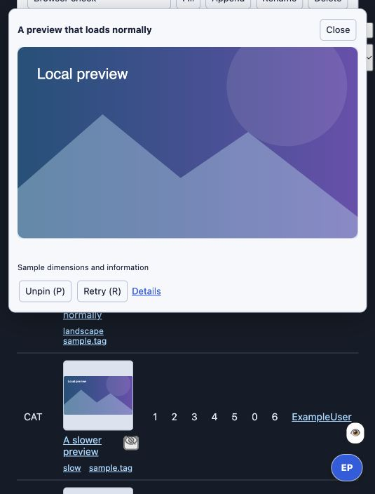

Version 2 adds checks for one visible workspace, adoption of working filter inputs, shared Apply/keyboard Save behavior, result visibility, actions with context menus disabled, old-default migration, independent thumbnail/large-image lanes, reserved hover capacity, demand priority, immediate fallback, direct image targets surviving eviction, abandoned-preview cancellation and pin handoff.

Version 2.0.1 audits text, tooltips, accessible names, placeholders, context menus, reset/bulk-action confirmations, import failures, notification controls, dynamically added rows, and userscript-manager metadata. Routine UI uses Companion/Filters terminology. Original project names remain in attribution and legacy-import documentation. Stored keys and backup fields remain compatible.

Version 2.1 adds checks for automatic persistence without navigation, caret/trailing-space preservation, live checkbox rules, reversible Hard Pass removal, immediate import, invalid-draft validation before writes, repeated detail-page updates, stable image transfers during size changes, quick-save naming/deduplication, hover click-through, hover-off/click-to-pin, Undo preserving newer searches, automatic recovery of an already-open failed preview, and suppression of hidden-image error noise.

The usability browser pass verifies that typing a tag hides matching rows without an Apply click, Undo restores them, Save search leaves the library closed, and hovering a thumbnail still permits clicking it to pin. The routine Images pane has four controls and an automatic-save status.

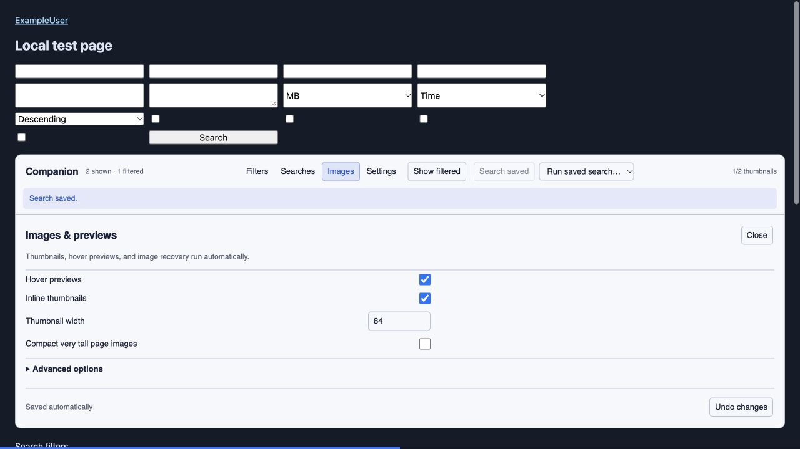

Version 2.1.1 adds four tests for preparing all 50 thumbnails without scrolling or IntersectionObserver, distance priority, skipping hidden/detached rows, waking revealed queued rows without user input, waiting for filters, background-tab pause/resume, and new offscreen results while galleries remain deferred. The built script's long-page browser fixture loaded all 50 real inline images in 1,324 ms at scroll offset zero; row 50 was 7,219 px below the viewport origin. Responses were local neutral SVGs with controlled delay and no-store headers. This is a queue-policy check, not a live-host speed guarantee.

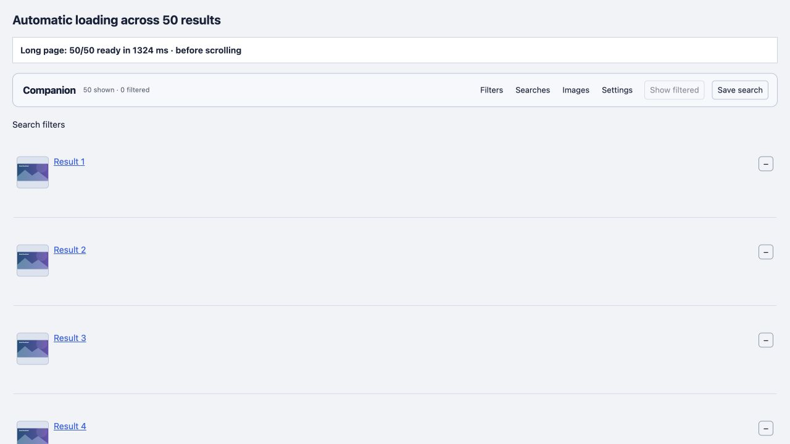

Version 2.2 adds 15 checks covering current-search URL restrictions, five-page batching, duplicate IDs, duplicate-only pages, empty-page termination, original/response numbered-pager fallback, overlay-name collisions, inert script handling, metadata surviving media restarts, filtering before image requests, Show filtered, partial-failure continuation, concurrent-click exclusion, Stop/stale responses, timeouts/login/non-HTML/redirect responses, fork preference migration and backup precedence, autosave/Undo, media-disabled mode, unsupported pages, filter-failure rollback and full-engine backfill integration. The engine integration also exercises whitelist/individual overrides, Hard Pass removal/restoration, context menus and unique row controls.

The local browser fixture starts with three rows (two shown, one filtered). One Backfill results click reads three following pages, each overlapping the previous one, yielding nine unique rows: five shown and four filtered. All five eligible thumbnails load, three pager links are marked included, and Next/backfill become unavailable at the end. Show filtered then reveals all four hidden rows, including appended ones. The fixture uses neutral local assets and mock GM storage; no production account or downloads are involved.

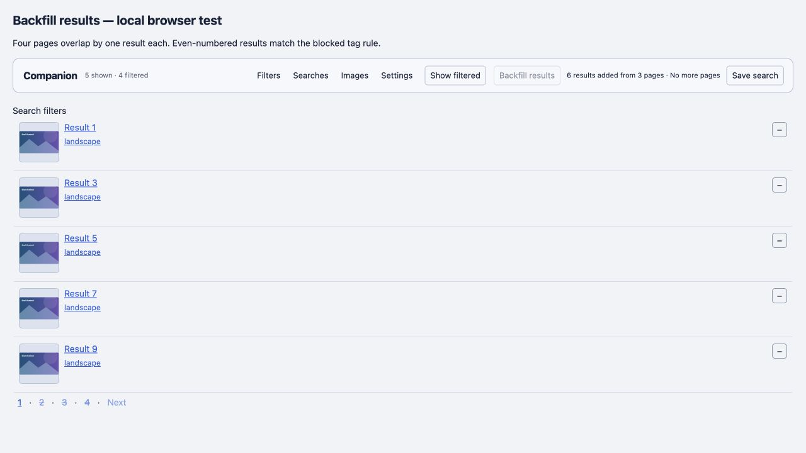

Version 2.3 adds six checks for immediate inline enlargement despite a configured title delay, usable-thumbnail display while requesting the larger variant, hidden controls in hover mode, immediate dismissal despite focused buttons, moving onto the enlargement, clicking the enlargement without restarting its transfer, pinned persistence, keyboard/touch access, pointer cancellation, window blur and pointer-capture recovery. Existing hover-off, preview retry/recovery and title-hover checks continue to pass.

The browser pass used the final built script on the neutral fixture. Pointer entry enlarged a 64-pixel thumbnail to a 426-pixel-wide image with no header/action row; the thumbnail remained visible while the original loaded. Moving away closed the enlargement while the thumbnail button retained focus. Moving onto the enlargement kept it available, and clicking it displayed the pinned controls. Moving away from that pinned preview kept it open.

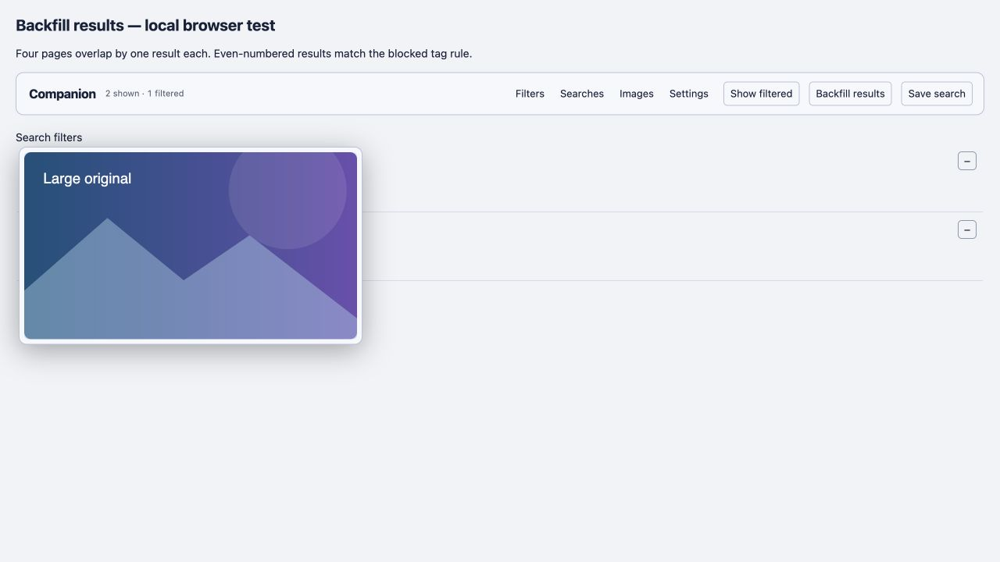

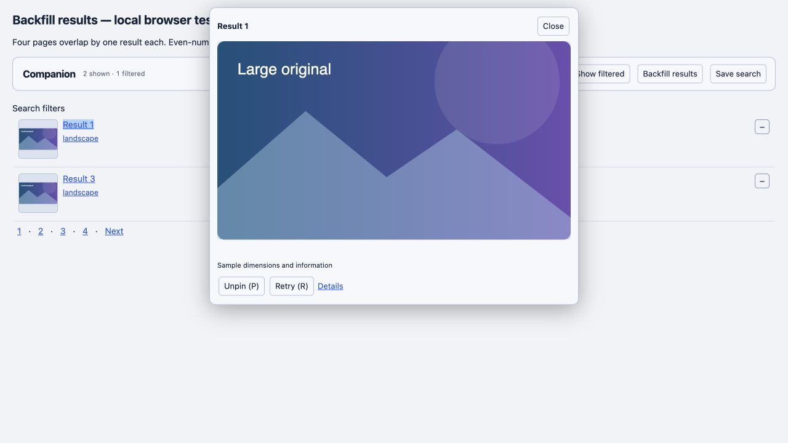

Version 2.4 adds six checks for primary shortcut visibility independent of panels/drawers, alphabetical display without duplicate UI, direct navigation with saved criteria, preserving unsaved form drafts, unchecked-filter/credential exclusion, shortcuts on pages without a search form, collapsed-form and nested-field reveal, preserving custom checkbox styling, focus and explicit Search now feedback, merging criteria without immediate navigation, escaped titles, imports/empty states and other-tab updates. The existing rename/delete/Undo test also checks the primary row. Page scans now stop when their window document is no longer available.

The browser fixture began with three saved names visible while both management and the native search form were closed. Clicking Landscapes navigated to a new page with its tag/category query, and the server-rendered Current results text reflected those criteria. Edit search form opened the collapsed form and focused Tags. After entering a draft keyword, Add to search form merged another saved tag and showed persistent feedback while the current results remained unchanged. Search now then reloaded results with the keyword and both tags. The URLs excluded the fixture's hidden credential sentinel. Tests use neutral local data and mock GM storage.

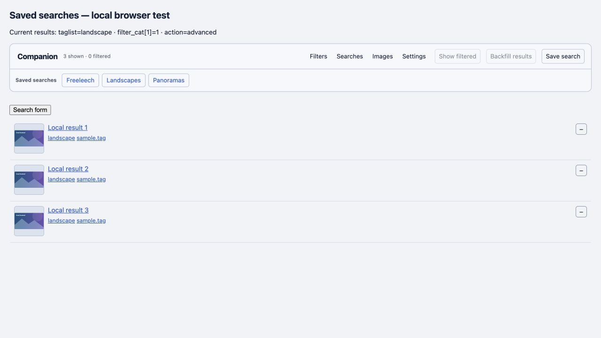

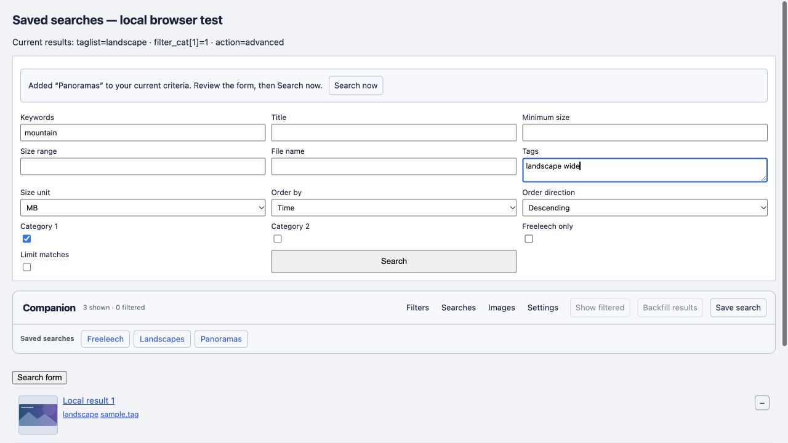

Version 2.5 adds five checks for three task areas, two visible common preferences, two initial tag fields, closed advanced/rule groups, advanced search results and restoration of disclosure state, no preference writes from searching, preservation of custom media/font/color values during ordinary saves, active-rule summaries, manual-only search management, folded per-search actions, and contextual toolbar actions. Existing filtering, backfill, backup, saved-search navigation, image-loading and hover checks continue to pass.

The local browser pass verified the final compact Settings view, the two-field Filters view, folded search management with primary shortcuts still visible, and an Advanced search for cache showing only two cache controls. These checks use the built script, mock GM storage and neutral local assets, not a live Tampermonkey installation.

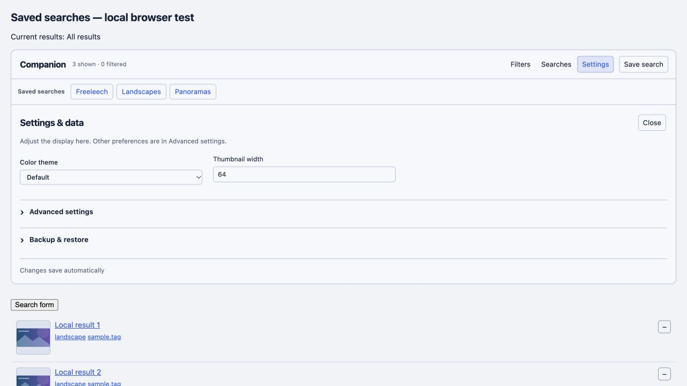

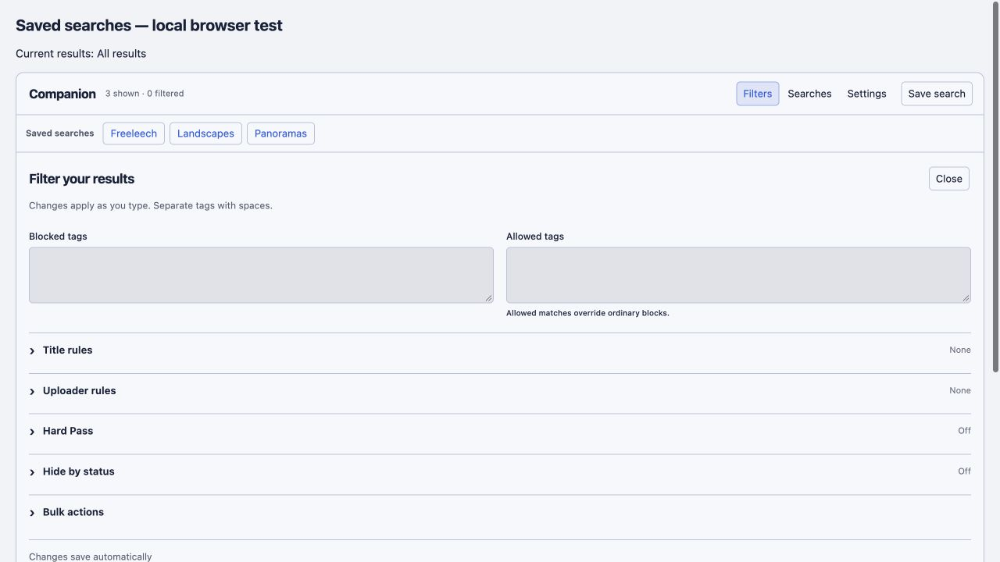

Version 2.6 replaces the previous native-form editing check with a contextual-editor regression check and adds six tests: saved fields/options absent from the native form, unchanged-field round trips, Cancel/Escape, invalid names and storage failure, preservation of other searches, same-search conflict handling, draft retention through panel switches/redraws, and radio/multiselect criteria. The existing no-form test now verifies editing there too. Tests assert that the site form/draft, current URL, and management context remain unchanged; only Save changes writes the edited search. IME confirmation does not submit it.

The browser pass opened More → Edit search for the tag-only Landscapes profile. Its Tags and checked Category were prefilled directly in that row; the site's form stayed collapsed and Searches stayed open. Cancel discarded an edited tag while keeping the original shortcut. A subsequent Save changed the shortcut's tag query, with the page URL and native form unchanged. The fixture uses neutral assets and mock GM storage.

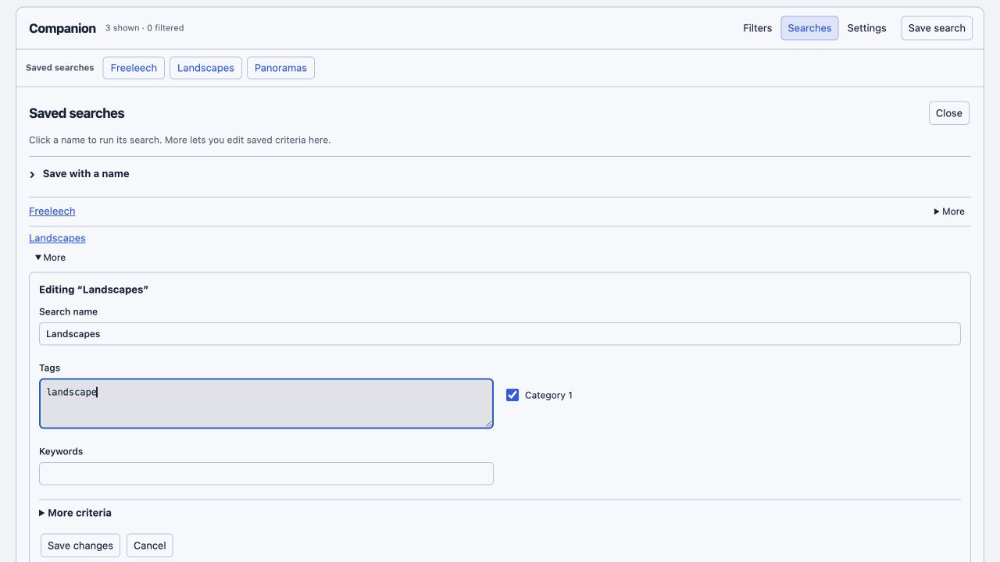

Version 2.7 adds 19 automated checks for conservative release identity, descriptor parsing, boolean/negative search terms, literal wildcard matching, original row/handler preservation, restoration of row order, representative promotion under filters, expanded-state retention, dynamic/backfilled groups, table/category boundaries, collapsed-thumbnail deferral, highlight-only actions, storage failures, backup/Undo, keyboard access, folded controls and Open visible results. Existing detail-page checks now also cover retaining a favorite through repeated visibility rule changes. Invalid highlight drafts are validated before filter or Companion preference writes.

The local browser fixture verifies six original rows becoming three displayed rows, expansion into original versions with independently loaded thumbnails, preservation of differently dated releases, a single compact tag menu, highlight changes across collapsed and visible versions without filtering, and folded Tag highlights controls. Both light and dark page backgrounds were inspected at 1280 × 720. Only neutral local images and mock GM storage were used. Native live category markup was read to confirm the parser's category selector.

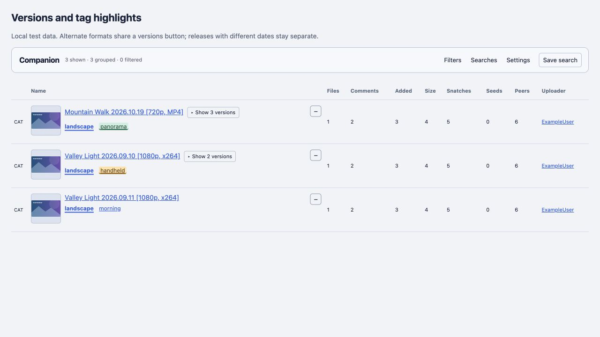

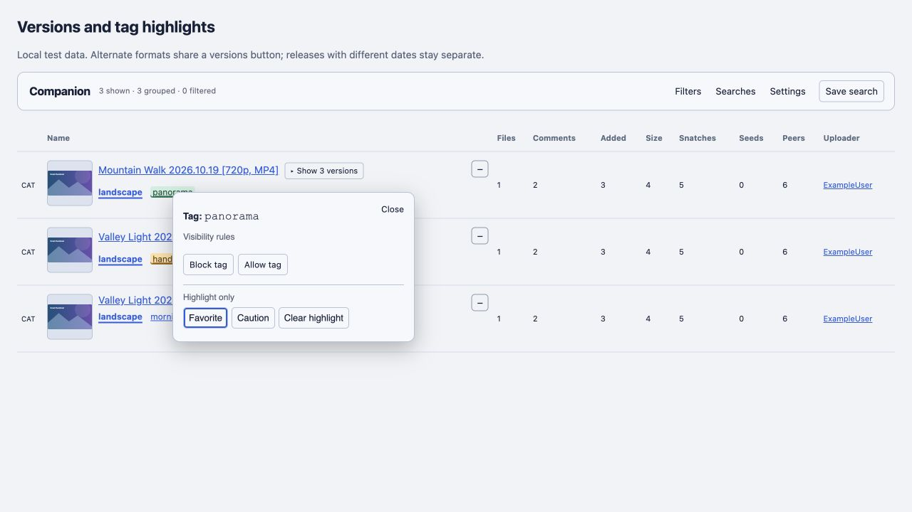

Version 2.7.1 adds 11 structural performance regressions: coalesced roots; local image bursts with zero list passes; nested mutation deduplication; title changes still regrouping; cached group expansion; indexed highlight changes and removal/rename cleanup; highlight-only saves preserving media; queued/completed thumbnails leaving scroll tracking; replacement search forms; deferred startup scanning; coalesced health updates and idle scanning; and reversible column stabilization with native-colgroup preservation. The priority test waits for the new initial rendering frame before asserting transfer order.

Actual Chromium runs compare 2.7.0 and 2.7.1 at 50/300/800 rows, including image churn, scrolling, version expansion, tag changes, insertion and idle behavior. A separate real-image test confirms all 50 thumbnails load before scrolling. See [timings, raw JSON and limitations](PERFORMANCE.md#cpu-and-rendering-pass-version-271).

Version 2.7.2 fixes re-entering the same thumbnail after dismissing its enlargement. The previous code retained the last item's metadata while hide cleared its image, so a subsequent hover skipped the usable-thumbnail fallback. Reuse now requires an open preview session. Two regression tests cover interrupted requests, restoration of the ready thumbnail on return, stale completions, completed-original cache reuse, eight repeated cancellations without spending failure retries, no extra page scans and the existing click-to-pin handoff.

The local Chromium check used native pointer entry, exit and immediate re-entry while the original image had a three-second response delay. The returned enlargement immediately displayed the usable 160-pixel thumbnail, then replaced it with the completed original. Completed-image re-entry and click-to-pin were also checked.

The v2 local browser test uses the current 1280 × 720 viewport, verifies the combined controls, and compares controlled loading policies. See [performance results](PERFORMANCE.md). One real image-host small URL was also confirmed to return a 160 × 160 image through normal browsing, without downloading a file.

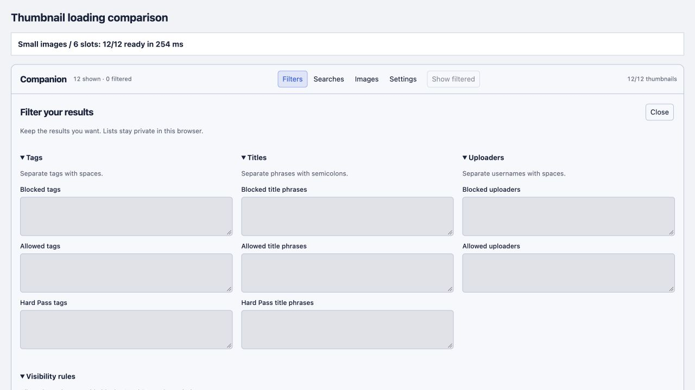

This is not a live Tampermonkey installation test in the user's Chrome profile. The fixture supplies mock GM APIs. Browser-specific extension isolation and the real site's current DOM still need an installation smoke test.

Open-all, account-specific notification forms, every theme permutation and all detail-page layouts were retained from the pinned engine but not individually exercised against the production account. No live site settings were changed or torrent downloads initiated.

October 23 adds four experimental concurrency tests (6/8/12/16), verifying queue bounds, two ordinary large slots and reserved hover capacity, successful drainage and no duplicate transfers. The [48-trial browser comparison](CONCURRENCY-EXPERIMENT.md) retains the default 6 after observing host-dependent regressions; the product file is unchanged. [Earlier 175-check suite](qa/concurrency-full-2026-10-23.xml).
